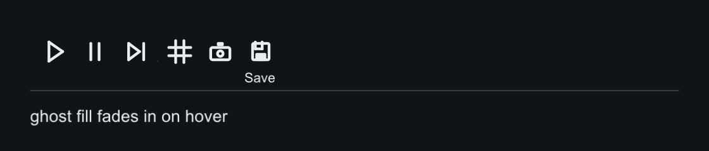
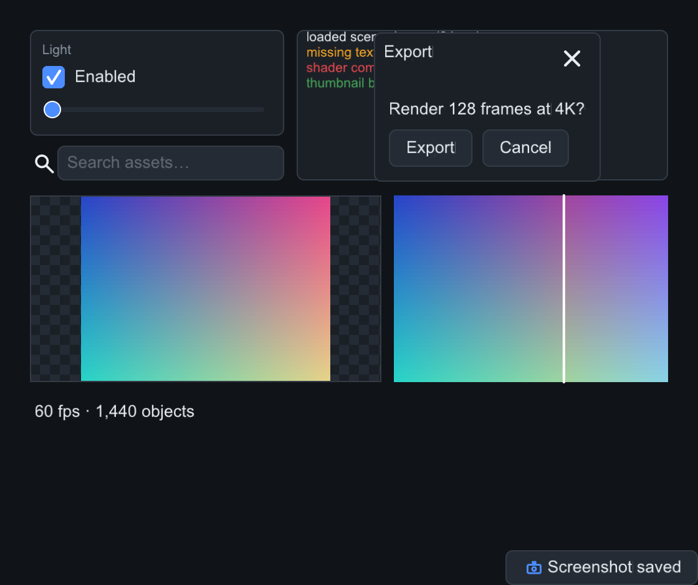

# slikui — a sleek, header-only C++ UI library for graphics applications

[](https://github.com/jamesgregson/slikui/actions/workflows/cpp.yml)
[](https://github.com/jamesgregson/slikui/actions/workflows/python.yml)

Retained-mode widget tree, declarative builder API, one narrow rendering
contract that runs on **raw pixels or any graphics API**. C++20, no build
step, no dependencies.

```cpp
#include "slikui.hpp"                 // or dist/slikui.hpp — the single header

#include <slikui/backends/software/software.hpp>   // CPU rasterizer
#include <slikui/text/system_fonts.hpp>            // find_system_font()

int main() {
    slikui::software::Target target(480, 320);     // raw uint32_t pixels
    slikui::software::Sink sink(target);
    slikui::Context ctx(sink);
    ctx.set_frame_size({480, 320});
    ctx.load_font_file(slikui::find_system_font());

    auto& root = ctx.set_root<slikui::Column>();
    root.set_padding(16).set_gap(8);
    root.add<slikui::Label>("Hello, slikui!");
    root.add<slikui::Button>("Click me").on_click([] { /* ... */ });

    while (running) {
        ctx.handle(event);                        // translated input events
        ctx.tick(slikui::Time{now, dt});            // layout + animation
        ctx.render();                             // -> pixels
    }
}
```


## Contents

- [Highlights](#highlights)
- [Component reference](#component-reference)
  - [Buttons](#buttons) · [Checkbox, Radio, Switch](#checkbox-radio-switch) ·
    [Slider, ProgressBar, Spinner](#slider-progressbar-spinner) · [Label](#label) ·
    [TextField, TextArea](#textfield-textarea) · [Editors](#editors) ·
    [ListView, Tabs, Dropdown](#listview-tabs-dropdown) ·
    [Menus & shortcuts](#menus--shortcuts) · [Toolbar, IconButton, icons](#toolbar-iconbutton-icons) ·
    [Plot, TreeView, Table, PropertyGrid](#plot-treeview-table-propertygrid) ·
    [Dialogs, toasts, status & logs](#dialogs-toasts-status--logs) ·
    [Panel, Row, Column, Spacer, Divider](#panel-row-column-spacer-divider) ·
    [Expander, Accordion, Splitter](#expander-accordion-splitter) ·
    [Image](#image) · [Tooltips](#tooltips) · [Theming](#theming)
- [Building the demos](#building-the-demos)
- [Python bindings — `slikui`](python/README.md) — full Python API, events,
  custom widgets (subclass `Widget` in Python), your-own-renderer seam, parity
  tests
- [Documentation](#documentation)
- [Roadmap](#roadmap)

## Highlights

- **Header-only** — include `slikui.hpp` (multi-header) or `dist/slikui.hpp`
  (amalgamated single file). No linking, no code generation.
- **Two backends out of the box**
  - `slikui::software::Sink` — antialiased rasterizer over a raw `uint32_t`
    framebuffer (owned or borrowed). Works headless, on embedded targets, or
    blitted into any engine. `sink.set_scale()` renders logical coordinates
    at any pixel density.
  - `slikui::opengl::OpenglSink` — GL 3.3 core renderer using your **system
    OpenGL headers** (no vendored loader). Optional `slikui::glfw::GlfwWindow`
    wraps window creation and event translation.
  - Anything else (Vulkan, Metal, SDL_Renderer) implements one interface:
    see `docs/backend-contract.md`.
- **True type text** — vendored public-domain stb_truetype/stb_rect_pack,
  compiled with internal linkage: glyph atlas, kerning, word wrapping.
  Optional bundled font: `#include <slikui/text/default_font.hpp>` (or
  `dist/slikui_default_font.hpp`) embeds a ~35 KB DejaVu Sans subset (Latin-1
  + punctuation) for identical text everywhere, even on machines with no
  system fonts — `ctx.load_font_memory(slikui::text::default_font_data(),
  slikui::text::default_font_size())`. Licence:
  `third_party/fonts/LICENSE-DejaVu.txt`; ship it with your app.
- **Widget set** — Label, Button (variants), Checkbox, Radio, Switch, Slider
  (label/format/log/step), ProgressBar, Spinner, TextField (selection +
  clipboard), TextArea (multiline), ScrollArea, ListView, Tabs, Dropdown
  (popup), Expander, Accordion, Splitter, Image, hover tooltips; DragValue,
  Vec2/3/4Edit (borrowed numpy buffers), ColorEdit (SV + hue popup),
  Segmented; MenuBar/Menu (context menus, shortcut table), Toolbar/
  IconButton with a procedural icon set; Plot (lines/bars/fill), TreeView,
  Table, PropertyGrid, Vec2Pad; Panel, Column, Row, Spacer, Divider — see
  `slikui/widgets/all.hpp` and `docs/widgets-roadmap.md` for what's next.
- **Theme + animation** — palette-driven styling with 8 built-in presets
  (Dark, Light, Nord, Dracula, Gruvbox, Mocha, Solarized, Phosphor),
  hover/press transitions, `Anim` tween helper.
- **Input** — one event vocabulary (`slikui::Event`) translated by the window
  layer; hit-testing, focus, Tab navigation, mouse capture, popups.

Every image below is real output: `tools/components_capture.cpp` builds each
tree with the **software backend**, simulates a second of interaction, and
dumps the framebuffer — the code snippets are the actual capture code.

---

## Component reference

### Buttons

`Button` comes in four variants: `Default`, `Primary` (accent fill),
`Danger`, and `Ghost` (borderless, quiet action). `on_click` fires on release
inside the widget; hover/press transitions are animated by the theme.

```cpp
auto& row = root.add<slikui::Row>();
row.set_gap(10);
row.add<slikui::Button>("Default");
row.add<slikui::Button>("Primary").set_variant(slikui::Button::Variant::Primary);
row.add<slikui::Button>("Danger").set_variant(slikui::Button::Variant::Danger);
row.add<slikui::Button>("Ghost").set_variant(slikui::Button::Variant::Ghost);
```


### Checkbox, Radio, Switch

All three are bool controls with `set_checked(bool, bool fire_callback)` and
`on_change(void(bool))`. `Radio` gives you the visuals; exclusivity within a
group is yours to wire (set the others false in the callback).

```cpp
auto& row = root.add<slikui::Row>();
row.set_gap(18);
row.add<slikui::Checkbox>("Sync files", true);
row.add<slikui::Checkbox>("Compress", false);
row.add<slikui::Radio>("Wi-Fi", true);
row.add<slikui::Radio>("Ethernet", false);
row.add<slikui::Switch>().set_checked(true);
row.add<slikui::Switch>().set_checked(false);
```


### Slider, ProgressBar, Spinner

`Slider` drives a float range (`set_range`, `set_value`, `on_change`) and can
carry its own caption row — `set_label` adds a title with a live formatted
value on the right (`set_format`, e.g. `"%.2f"`), `set_log_scale` makes
picking across magnitudes sane, and `set_step` quantizes clicks and wheel
ticks. `ProgressBar` shows a clamped 0–1 fraction; `Spinner` animates forever
and takes `set_speed` (degrees per second) — it is driven by the time you
pass to `ctx.tick`, so it pauses with your app.

```cpp
auto& cap = root.add<slikui::Row>();
cap.add<Label>("Volume");
cap.add<Spacer>();
cap.add<Label>("62%").set_color(ctx.theme().text_dim);
root.add<Slider>(0.f, 100.f).set_value(62.f);
root.add<ProgressBar>().set_value(0.72f);
root.add<Spinner>();                       // + a dim Label next to it
```


### Label

Static text: `set_font_size` overrides the theme's base size, `set_color`
overrides the theme text color, `set_wrap_width` word-wraps.

```cpp
root.add<Label>("Title — 26 px").set_font_size(26);
root.add<Label>("Body label at the default 15 px size.");
root.add<Label>("Dim secondary text.").set_color(ctx.theme().text_dim);
root.add<Label>("Accent-colored label.").set_color(ctx.theme().accent);
```


### TextField, TextArea

Single-line and multiline editing with caret, drag/Shift+arrow selection,
Home/End/arrow navigation, and auto-scroll. `on_change` fires on every edit,
`on_submit` on Enter (TextField). `set_password` masks a TextField.
Ctrl/Cmd+A/C/X/V read and write the host clipboard via
`ctx.set_clipboard_source/sink` (the GLFW backend wires the system
clipboard; without a host the shortcuts are silent no-ops).

```cpp
root.add<TextField>().set_text("jane@example.com").set_placeholder("you@host");
root.add<TextField>().set_placeholder("Search…");
root.add<TextArea>().set_rows(3)
    .set_text("slikui renders this entirely on the CPU —\n"
              "no GPU, no window, no dependencies.");
```


### Editors

Widgets for tuning numbers and colors in demo panels — all C++ core, so the
Python bindings get the same surface (see `python/tests/test_editors.py`).

`DragValue` scrubs a value like Blender number fields: drag horizontally to
change it, click to type, Enter commits, Escape cancels, arrows nudge when
focused. `Vec2Edit`/`Vec3Edit`/`Vec4Edit` give one labeled field per axis and
**borrow** the caller's `float[N]` — edits write into it and external writes
mirror back on the next tick (numpy arrays work as-is). `ColorEdit` is a
swatch that opens an SV square + hue popup with hex and RGBA fields.
`Segmented` is a compact radio-style row.

```cpp
root.add<Segmented>().set_items({"Cube", "Sphere", "Torus"}).set_selected(1);
static float light_dir[3] = {0.60f, 0.40f, 0.70f};
root.add<Vec3Edit>(light_dir, "XYZ");   // borrows the array, mirrors it each tick
root.add<DragValue>(1.5f).set_prefix("exp ").set_suffix(" EV");
root.add<Slider>(0.f, 1.f).set_label("Roughness").set_format("%.2f").set_value(0.35f);
auto& colors = root.add<Row>();
colors.set_gap(8);
colors.add<ColorEdit>(Color::from_hex(0xBF5C38));  // click → SV + hue popup
```


### ListView, Tabs, Dropdown

`ListView` is a selectable item list (`on_select(void(size_t))`). `Tabs` is a
tab bar (`set_tabs`, `on_change`). `Dropdown` opens its selection popup on
click — the screenshot shows it after a simulated press:

```cpp
auto& list = row.add<ListView>();
list.set_items({"alpha", "beta", "gamma", "delta"}).set_selected(1);
col.add<Tabs>().set_tabs({"Home", "Edits", "View"}).set_selected(1);
col.add<Dropdown>().set_items({"Linear", "Nearest", "Cubic", "Lanczos"})
    .set_placeholder("Filter…").set_selected(0);
```


### Menus & shortcuts

`MenuBar` is a top strip of menu titles: click to open, click again to close,
and with a menu open, hovering another title switches to it. `Menu` holds
items (`add_item`, `add_checkable`, `add_submenu`, `add_separator`) with
right-aligned shortcut hints; disabled items swallow clicks. Menus are
**borrowed** popups — build once, open many times; checkmark state is read
through a callback at paint time and `on_open` fires before each show so you
can refresh enabled flags. Escape unwinds submenus one level per press.

Any widget can carry a right-click menu: `widget.set_context_menu(&menu)` —
the nearest ancestor with one wins. Global accelerators live on the Context:
`ctx.add_shortcut(Key::S, ModCtrl, save)` fires before widget dispatch (a
modifier is required, so typing never triggers one).

```cpp
auto& bar = root.add<MenuBar>();
auto& file = bar.add_menu("File");
file.add_item("Open…", open_fn, "Ctrl+O");
file.add_item("Save", save_fn, shortcut_label(Key::S, ModCtrl));
file.add_separator();
file.add_item("Quit", quit_fn, "Ctrl+Q");
auto& view = bar.add_menu("View");
view.add_checkable("Grid", [] { return show_grid; },
                   [&](bool) { show_grid = !show_grid; });
viewport.set_context_menu(&view_menu);          // right-click
ctx.add_shortcut(Key::R, ModCtrl, render_fn);   // global accelerator
```


### Toolbar, IconButton, icons

`Toolbar` is a strip of `IconButton`s — Button interaction (hover/press
animation, keyboard activation, variants) with a procedural icon instead of
text. The icon set in `widgets/icons.hpp` (~26: play, pause, step, grid,
camera, save, refresh, search, …) is painted from DrawList primitives —
no icon font, no assets, resolution-independent and theme-tinted.
`add_button(icon, label, …)` renders a small caption under the icon.

```cpp
auto& bar = root.add<Toolbar>();
bar.add_button(Icon::Play, run_fn, "Run");
bar.add_button(Icon::Pause, pause_fn);
bar.add_separator();
bar.add_button(Icon::Grid, grid_fn, "Toggle grid");
bar.add_button(Icon::Save, "Save", save_fn);   // labeled
```



### Plot, TreeView, Table, PropertyGrid

The data-display family for demo panels. `Plot` draws line series with
autoscale (or `set_x_range`/`set_y_range`), grid + tick labels, optional
area fill, markers — and `set_bars` turns series 0 into a histogram.
`TreeView` takes a flat `(label, depth, expandable)` row list; expansion
state lives in the widget, chevron clicks toggle, rows select.
`Table` is columns + header + selectable rows with per-column alignment and
cell clipping. `PropertyGrid` is the inspector: `add_property(label)` rows
with a fixed label column (drop any editor into the returned row) and
collapsible `add_section`s. `Vec2Pad` (bottom left) is a 2D pad with a
draggable dot — light direction, UV offsets.

```cpp
auto& plot = left.add<Plot>().set_fill(true);
plot.set_series(frame_times_ms, ctx.theme().accent);   // numpy or std::vector
plot.set_bars(false).set_markers(false);

right.add<TreeView>().set_rows({
    {"Scene", 0, true}, {"Dragon", 1}, {"Lights", 0, true}, {"Sun", 1},
});
auto& table = right.add<Table>();
table.set_columns({{"Mesh", 100}, {"Tris", 60, true_align_right…}});
table.set_rows({{"Dragon", "870k", "4"}}).set_selected(0);

auto& grid = root.add<PropertyGrid>();
grid.add_property("Roughness").add<Slider>(0.f, 1.f);
auto& mat = grid.add_section("Material", true);
mat.add_property("Metallic").add<Slider>(0.f, 1.f);
```


### Dialogs, toasts, status & logs

Floating shells live on their own layer above popups. `Dialog` has a
draggable title bar with a close button and a `content()` column;
`MessageBox` adds an action-button row; a **modal** dialog dims the app and
traps presses outside it. `StatusBar` shows status text with transient
messages plus right-side widgets, `Toast` posts auto-dismissing corner
notices, and `LogView` is a severity-colored autoscrolling console.
`FileBrowser` lists real directories (Open/Save), `ImageView` pans/zooms
bitmaps over a checkerboard, `CompareView` splits two images with a
draggable divider. Widgets can request cursor shapes via `set_cursor`
(hosts map them to system cursors — `GlfwWindow::attach` does this).

```cpp
auto mb = std::make_unique<slikui::MessageBox>("Delete", "Remove \'dragon.obj\'?");
mb->set_modal(true);
mb->add_button("Delete", [&] { remove_item(); });
mb->add_button("Cancel", nullptr);
ctx.open_dialog(std::move(mb));   // owned; or open_dialog(mb) to borrow
ctx.push_toast(std::make_unique<slikui::Toast>("Saved"), 3.0);
```

```python
mb = slikui.MessageBox("Delete", "Remove \'dragon.obj\'?")
mb.set_modal(True)
mb.add_button("Delete", lambda: remove_item())
mb.add_button("Cancel", lambda: None)
ui.ctx.open_dialog(mb)            # borrowed — keep the Python object alive
ui.ctx.push_toast("Saved", 3.0)
```




### Panel, Row, Column, Spacer, Divider

Layout is immediate-mode in spirit but retained in the tree: `Column` and
`Row` stack children with `set_gap` and `set_padding`, distribute extra space
to children that expand, and align cross-axis with `set_cross`
(`CrossMode::Stretch`, `Start`, `Center`). `Panel` is a bordered, rounded
container; `Spacer` soaks up remaining space; `Divider` draws a rule.

```cpp
auto& panel = root.add<Panel>();
panel.set_padding(14).set_gap(10);
panel.set_radius(10);
panel.add<Label>("Panel — a bordered container");
auto& top = panel.add<Row>();
top.add<Label>("left");
top.add<Spacer>();          // pushes "right" to the far edge
top.add<Label>("right");
panel.add<Divider>();
auto& bot = panel.add<Row>();
bot.set_gap(16);
bot.add<Checkbox>("Snap", true);
bot.add<Checkbox>("Grid", false);
```


### Expander, Accordion, Splitter

`Expander` shows/hides its subtree behind a titled header
(`set_open`, `on_toggle(void(bool))`) — closed children get zero frames and
skip hit-testing.

`Accordion` stacks Expander sections. `add_section(title, open = false)`
returns the section's `Expander` (itself a `Container`) — fill it with rows,
sliders, whatever the group needs. By default the accordion is **exclusive**:
opening one section closes the others, so at most one is expanded;
`set_exclusive(false)` lets every section stand open.

```cpp
auto& acc = root.add<slikui::Accordion>();
acc.set_gap(6);
auto& shape = acc.add_section("Shape", /*open=*/true);  // open by default
shape.set_gap(8);
shape.add<Dropdown>().set_items({"Cube", "Sphere", "Torus"});
auto& material = acc.add_section("Material");
material.set_gap(8);
material.add<Slider>(0.f, 1.f);          // roughness
material.add<Slider>(0.f, 1.f);          // metallic
```

`Splitter` divides two children with a draggable divider
(`set_fraction` 0–1, `on_change(void(float))`; construct with `true` for a
horizontal divider / stacked panes).

```cpp
auto& exp = root.add<Expander>("More options");
exp.set_open(true);
exp.add<Column>().set_gap(8)
    .add<Checkbox>("Compress", true);
auto& split = root.add<Splitter>();
split.set_fraction(0.45f);
split.add<Panel>().set_padding(12).add<Label>("left pane");
split.add<Panel>().set_padding(12).add<Label>("right pane");
```


### Image

Decodes PNG/JPEG via vendored stb_image. Feed it pixels you already have
(`set_pixels`), a file (`set_file`), or an encoded memory blob (`set_memory`).
`set_fit` chooses how the source maps into the widget rect: `Stretch`,
`Contain` (letterbox), `Cover` (crop). Textures upload through the same
`TexUpload` channel as the font atlas, so every backend gets it for free.

```cpp
auto& cell = row.add<Column>();
cell.set_gap(6).set_cross(CrossMode::Center);
cell.add<Image>("gradient").set_pixels(64, 48, grad_rgba)
    .set_size(150, 110).set_fit(Image::Fit::Contain);
cell.add<Label>("Contain").set_color(ctx.theme().text_dim);
```


### Tooltips

Any widget can carry a tooltip with `set_tooltip`. It appears after a ~0.6 s
hover delay and dismisses on mouse-away or click. Because setters return
`Widget&` (no deducing-this before C++23), base-class setters like
`set_tooltip` must come **last** in a chain.

```cpp
row.add<Button>("Save");
row.add<Button>("Delete all")
    .set_variant(Button::Variant::Danger)
    .set_tooltip("Removes every item — this cannot be undone");
```


### Theming

`ctx.theme()` is a plain struct: palette (`background`, `surface`,
`surface_alt`, `border`, `text`, `text_dim`, `accent`, `accent_text`,
`danger`, `success`, `warning`), metrics (`base_font_px`, `radius`,
`border_width`, `gap`, font sizes, `scale`), and derive helpers (`hover()`,
`press()`, `dimmed()`). Eight presets ship with the library — each varies the
palette *and* the corner radius, so every scheme gets its own character:
Dark, Light, Nord, Dracula, Gruvbox, Mocha (Catppuccin), Solarized, and
Phosphor (green CRT terminal, square corners).

```cpp
ctx.theme() = slikui::Theme::nord();              // simplest — resets scale too
slikui::use_theme(ctx.theme(), slikui::Theme::mocha()); // keeps your `scale`
slikui::apply_preset(ctx.theme(), 5);             // by index, wraps around

// Build a picker from the registry:
for (const auto& p : slikui::theme_presets()) names.push_back(p.name);
header.add<Dropdown>().set_items(names)
    .on_select([&](size_t i) { slikui::apply_preset(ctx.theme(), i); });
```

Set `theme().scale` for HiDPI: layout stays in logical points, each sink maps
them to device pixels (`sink.set_scale()`). Anything not in the preset list is
one struct away — assign the palette fields by hand.

```cpp
ctx.theme().scale = 2.f;          // retina-class density
sink.set_scale(ctx.theme().scale);
ctx.theme().accent = slikui::Color::from_hex(0xE060B0); // your brand
```


---

## Building the demos

```
cmake -S . -B build
cmake --build build -j
ctest --test-dir build          # golden-image pixel checks included
./build/examples/03_gallery/slikui_gallery
./build/examples/04_glfw_opengl     # 3D shape viewer: orbit + zoom + accordion panel
./build/examples/04_glfw_software   # same UI, CPU-rasterized scene
./build/examples/05_showcase/slikui_showcase
./build/examples/05_showcase/slikui_showcase --smoke showcase.png   # headless scripted pass
```

Examples: `01_hello` (GLFW+GL), `02_raw_pixels` (headless, writes a PPM),
`03_gallery` (all widgets), `04_glfw_opengl`, `04_glfw_software` (CPU
rasterizer in a window), `05_showcase` (every widget live). `04_glfw_opengl`
renders a lit reference shape (cube, sphere or torus — pick it in the
**Shape** section) over a procedural sky, and edits material, environment,
light and camera state live from an accordion control panel; drag to orbit,
scroll to zoom. `05_showcase` puts every component in one window — menu bar,
toolbar, splitter with six tabbed pages, status bar — and each one logs its
state changes into the on-screen event log as you use it; two custom widgets
(an expanding `Fill` wrapper and a `LevelMeter` with click/drag scrubbing,
peak-hold and a warning above 90%) show the measure/paint/event/tick
contract. `--smoke` drives a scripted pass over all of it headlessly
(synthetic mouse/key/scroll events) and writes a screenshot; its transcript
is byte-identical to the Python twin's (`python/examples/showcase.py`).

Regenerate the images above with:

```
clang++ -std=c++20 -Iinclude tools/components_capture.cpp -o /tmp/ccap
/tmp/ccap docs/images            # writes PPMs
for f in docs/images/*.ppm; do python3 tools/ppm2png.py "$f" "${f%.ppm}.png"; done
```

## Documentation

- `docs/architecture.md` — how the pieces fit together.
- `docs/backend-contract.md` — writing a new graphics-API backend.
- [`python/README.md`](python/README.md) — the Python bindings (`slikui`):
  install, widgets, events, and implementing your own renderer.

## Roadmap

Tracked in `docs/widgets-roadmap.md`: dialogs & file browser, tree/table
views, property grid, plots, toasts. Beyond that: resizable floating
windows, per-widget style overrides, dirty-region relayout.

MIT licensed. stb libraries are public domain.
