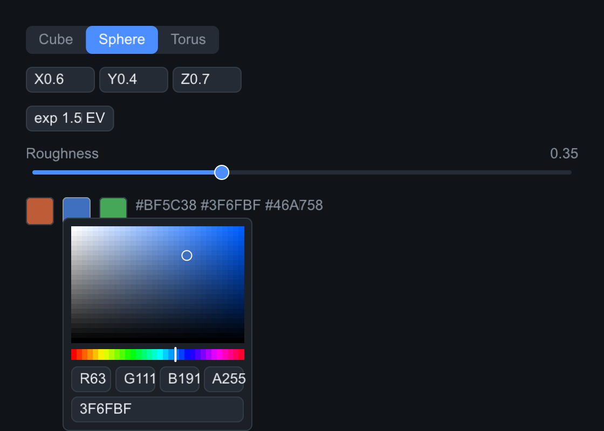
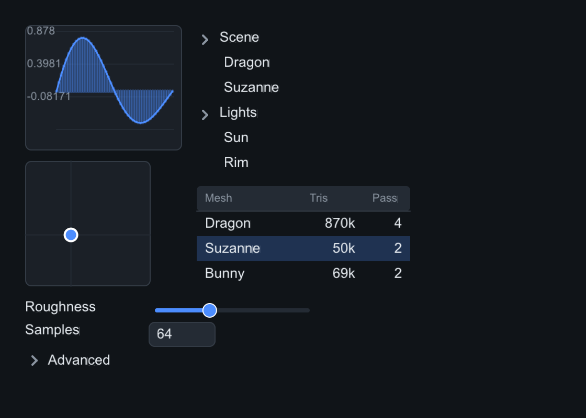
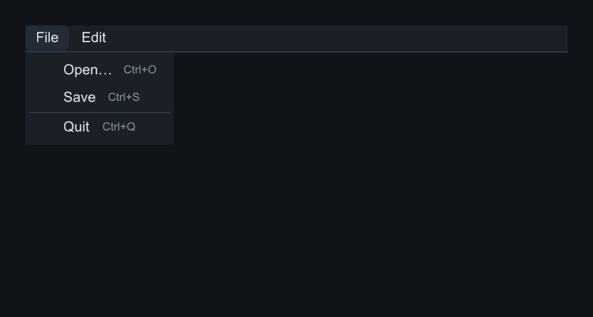

# slikui — a sleek, header-only C++ UI library for graphics applications

[](https://github.com/jamesgregson/slikui/actions/workflows/cpp.yml)
[](https://github.com/jamesgregson/slikui/actions/workflows/python.yml)
[](https://jamesgregson.github.io/slikui/)

Retained-mode widget tree, declarative builder API, one narrow rendering
contract that runs on **raw pixels or any graphics API**. C++20, header-only,
no dependencies — with [Python bindings](https://jamesgregson.github.io/slikui/getting-started/python/)
as first-class citizens.

**Docs: <https://jamesgregson.github.io/slikui/>** — guides, per-widget
reference with real rendered examples, and the whole site as plain markdown
for agents and offline use
([llms.txt](https://jamesgregson.github.io/slikui/llms.txt),
[llms-full.txt](https://jamesgregson.github.io/slikui/llms-full.txt)).


## Quickstart

**C++** — drop in the header, build a tree, drive the frame loop
([more](https://jamesgregson.github.io/slikui/getting-started/cpp/)):

```cpp
#include "slikui.hpp"                             // or dist/slikui.hpp
#include <slikui/backends/software/software.hpp>  // CPU rasterizer
#include <slikui/text/system_fonts.hpp>           // find_system_font()

slikui::software::Target target(480, 320);        // raw uint32_t pixels
slikui::software::Sink sink(target);
slikui::Context ctx(sink);
ctx.set_frame_size({480, 320});
ctx.load_font_file(slikui::find_system_font());

auto& root = ctx.set_root<slikui::Column>();
root.set_padding(16).set_gap(8);
root.add<slikui::Label>("Hello, slikui!");
root.add<slikui::Button>("Save").set_variant(slikui::Button::Variant::Primary);

// frame loop: ctx.handle(event); ctx.tick(time); ctx.render();
```

**Python** — `pip install slikui-python`, headless by default
([more](https://jamesgregson.github.io/slikui/getting-started/python/)):

```python
import slikui

ui = slikui.App(320, 200)                          # Target + Sink + Context + font
root = ui.set_root(slikui.Column, padding=16, gap=8)
root.add(slikui.Label, "Hello, slikui!", font_size=26)
root.add(slikui.Button, "Save", variant=slikui.ButtonVariant.Primary)

ui.tick(0.0, 1 / 60)                               # layout + animation
frame = ui.render()                                # zero-copy (H, W) uint32 ndarray
```

## Highlights

- **Header-only** — `slikui.hpp` (multi-header) or `dist/slikui.hpp`
  (amalgamated). No linking, no code generation.
- **Backends** — CPU rasterizer over raw pixels (headless, embedded, blit
  into any engine) and GL 3.3 core on system headers. Anything else
  implements one interface: [Render backends](https://jamesgregson.github.io/slikui/guide/backends/).
- **Widget set** — 50+ widgets, from buttons and sliders to plots, trees,
  tables, menus, dialogs and image views:
  [widget index](https://jamesgregson.github.io/slikui/reference/).
- **Theming** — palette-driven styling, 8 built-in presets, HiDPI scale:
  [Theming](https://jamesgregson.github.io/slikui/guide/theming/).
- **Testable** — one event vocabulary, synthetic events drive the real
  dispatch path, golden-image pixel checks in CI:
  [Input & events](https://jamesgregson.github.io/slikui/guide/input-events/).

Every screenshot in the docs is real output:
`tools/components_capture.cpp` builds each tree with the software backend,
simulates a second of interaction, and dumps the framebuffer — the snippets
are the capture code.

| | | |
|---|---|---|
|  |  |  |
|  |  |  |

## Building the demos

```
cmake -S . -B build
cmake --build build -j
ctest --test-dir build          # golden-image pixel checks included
```

Six examples (`01_hello` … `05_showcase`) and the Python twins —
[Development](docs/development.md) has the full tour, plus how to regenerate
the docs images, amalgamate the header, and cut a release.

## License

MIT licensed. stb libraries are public domain; the bundled DejaVu Sans
subset carries its own licence (`third_party/fonts/LICENSE-DejaVu.txt`).
