# slikui — a sleek, header-only C++ UI library for graphics applications

[](https://github.com/jamesgregson/slikui/actions/workflows/cpp.yml)
[](https://github.com/jamesgregson/slikui/actions/workflows/python.yml)

Retained-mode widget tree, declarative builder API, one narrow rendering
contract that runs on **raw pixels or any graphics API**. C++20, no build
step, no dependencies.

```cpp
#include "slikui.hpp"                 // or dist/slikui.hpp — the single header

#include <slikui/backends/software/software.hpp>   // CPU rasterizer
#include <slikui/text/system_fonts.hpp>            // find_system_font()

int main() {
    slikui::software::Target target(480, 320);     // raw uint32_t pixels
    slikui::software::Sink sink(target);
    slikui::Context ctx(sink);
    ctx.set_frame_size({480, 320});
    ctx.load_font_file(slikui::find_system_font());

    auto& root = ctx.set_root<slikui::Column>();
    root.set_padding(16).set_gap(8);
    root.add<slikui::Label>("Hello, slikui!");
    root.add<slikui::Button>("Click me").on_click([] { /* ... */ });

    while (running) {
        ctx.handle(event);                        // translated input events
        ctx.tick(slikui::Time{now, dt});            // layout + animation
        ctx.render();                             // -> pixels
    }
}
```


## Contents

- [Highlights](#highlights)
- [Component reference](#component-reference)
  - [Buttons](#buttons) · [Checkbox, Radio, Switch](#checkbox-radio-switch) ·
    [Slider, ProgressBar, Spinner](#slider-progressbar-spinner) · [Label](#label) ·
    [TextField, TextArea](#textfield-textarea) ·
    [ListView, Tabs, Dropdown](#listview-tabs-dropdown) ·
    [Panel, Row, Column, Spacer, Divider](#panel-row-column-spacer-divider) ·
    [Expander, Accordion, Splitter](#expander-accordion-splitter) ·
    [Image](#image) · [Tooltips](#tooltips) · [Theming](#theming)
- [Building the demos](#building-the-demos)
- [Python bindings — `slikui`](python/README.md) — full Python API, events,
  your-own-renderer seam, parity tests
- [Documentation](#documentation)
- [Roadmap](#roadmap)

## Highlights

- **Header-only** — include `slikui.hpp` (multi-header) or `dist/slikui.hpp`
  (amalgamated single file). No linking, no code generation.
- **Two backends out of the box**
  - `slikui::software::Sink` — antialiased rasterizer over a raw `uint32_t`
    framebuffer (owned or borrowed). Works headless, on embedded targets, or
    blitted into any engine. `sink.set_scale()` renders logical coordinates
    at any pixel density.
  - `slikui::opengl::OpenglSink` — GL 3.3 core renderer using your **system
    OpenGL headers** (no vendored loader). Optional `slikui::glfw::GlfwWindow`
    wraps window creation and event translation.
  - Anything else (Vulkan, Metal, SDL_Renderer) implements one interface:
    see `docs/backend-contract.md`.
- **True type text** — vendored public-domain stb_truetype/stb_rect_pack,
  compiled with internal linkage: glyph atlas, kerning, word wrapping.
- **Widget set** — Label, Button (variants), Checkbox, Radio, Switch, Slider,
  ProgressBar, Spinner, TextField, TextArea (multiline), ScrollArea, ListView,
  Tabs, Dropdown (popup), Expander, Accordion, Splitter, Image, hover tooltips;
  Panel, Column, Row, Spacer, Divider — see `slikui/widgets/all.hpp`.
- **Theme + animation** — palette-driven styling with 8 built-in presets
  (Dark, Light, Nord, Dracula, Gruvbox, Mocha, Solarized, Phosphor),
  hover/press transitions, `Anim` tween helper.
- **Input** — one event vocabulary (`slikui::Event`) translated by the window
  layer; hit-testing, focus, Tab navigation, mouse capture, popups.

Every image below is real output: `tools/components_capture.cpp` builds each
tree with the **software backend**, simulates a second of interaction, and
dumps the framebuffer — the code snippets are the actual capture code.

---

## Component reference

### Buttons

`Button` comes in four variants: `Default`, `Primary` (accent fill),
`Danger`, and `Ghost` (borderless, quiet action). `on_click` fires on release
inside the widget; hover/press transitions are animated by the theme.

```cpp
auto& row = root.add<slikui::Row>();
row.set_gap(10);
row.add<slikui::Button>("Default");
row.add<slikui::Button>("Primary").set_variant(slikui::Button::Variant::Primary);
row.add<slikui::Button>("Danger").set_variant(slikui::Button::Variant::Danger);
row.add<slikui::Button>("Ghost").set_variant(slikui::Button::Variant::Ghost);
```

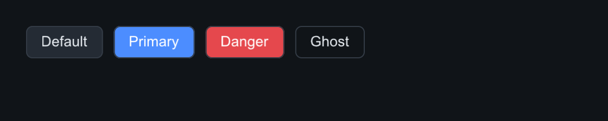

### Checkbox, Radio, Switch

All three are bool controls with `set_checked(bool, bool fire_callback)` and
`on_change(void(bool))`. `Radio` gives you the visuals; exclusivity within a
group is yours to wire (set the others false in the callback).

```cpp
auto& row = root.add<slikui::Row>();
row.set_gap(18);
row.add<slikui::Checkbox>("Sync files", true);
row.add<slikui::Checkbox>("Compress", false);
row.add<slikui::Radio>("Wi-Fi", true);
row.add<slikui::Radio>("Ethernet", false);
row.add<slikui::Switch>().set_checked(true);
row.add<slikui::Switch>().set_checked(false);
```

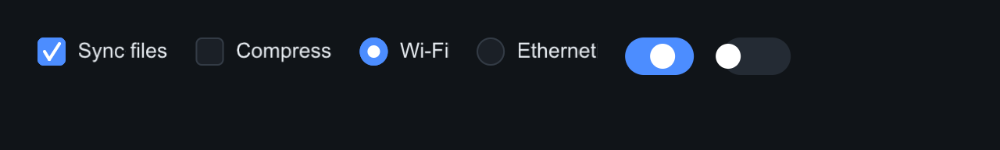

### Slider, ProgressBar, Spinner

`Slider` drives a float range (`set_range`, `set_value`, `on_change`);
`ProgressBar` shows a clamped 0–1 fraction; `Spinner` animates forever and
takes `set_speed` (degrees per second) — it is driven by the time you pass to
`ctx.tick`, so it pauses with your app.

```cpp
auto& cap = root.add<slikui::Row>();
cap.add<Label>("Volume");
cap.add<Spacer>();
cap.add<Label>("62%").set_color(ctx.theme().text_dim);
root.add<Slider>(0.f, 100.f).set_value(62.f);
root.add<ProgressBar>().set_value(0.72f);
root.add<Spinner>();                       // + a dim Label next to it
```

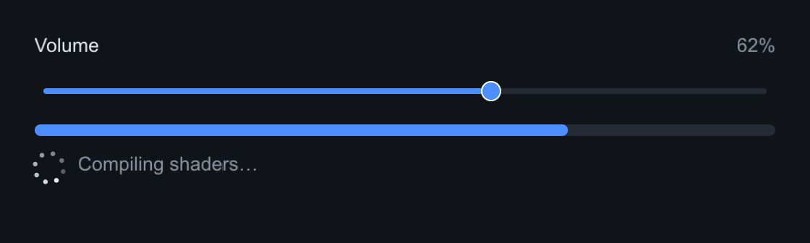

### Label

Static text: `set_font_size` overrides the theme's base size, `set_color`
overrides the theme text color, `set_wrap_width` word-wraps.

```cpp
root.add<Label>("Title — 26 px").set_font_size(26);
root.add<Label>("Body label at the default 15 px size.");
root.add<Label>("Dim secondary text.").set_color(ctx.theme().text_dim);
root.add<Label>("Accent-colored label.").set_color(ctx.theme().accent);
```

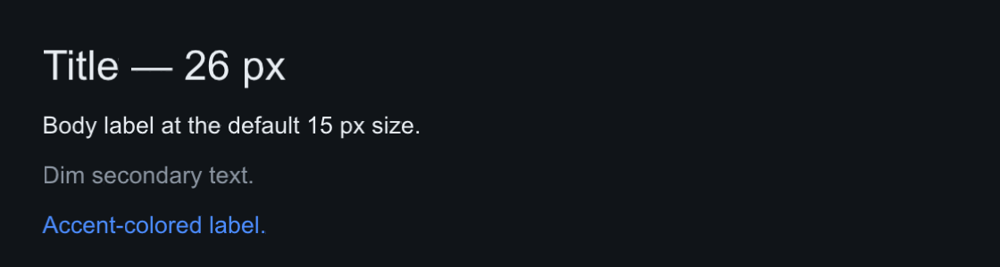

### TextField, TextArea

Single-line and multiline editing with caret, selection, Home/End/arrow
navigation, clipboard, and auto-scroll. `on_change` fires on every edit,
`on_submit` on Enter (TextField). `set_password` masks a TextField.

```cpp
root.add<TextField>().set_text("jane@example.com").set_placeholder("you@host");
root.add<TextField>().set_placeholder("Search…");
root.add<TextArea>().set_rows(3)
    .set_text("slikui renders this entirely on the CPU —\n"
              "no GPU, no window, no dependencies.");
```

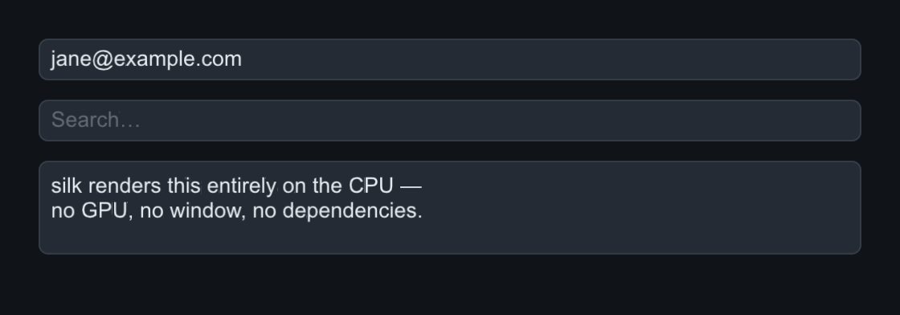

### ListView, Tabs, Dropdown

`ListView` is a selectable item list (`on_select(void(size_t))`). `Tabs` is a
tab bar (`set_tabs`, `on_change`). `Dropdown` opens its selection popup on
click — the screenshot shows it after a simulated press:

```cpp
auto& list = row.add<ListView>();
list.set_items({"alpha", "beta", "gamma", "delta"}).set_selected(1);
col.add<Tabs>().set_tabs({"Home", "Edits", "View"}).set_selected(1);
col.add<Dropdown>().set_items({"Linear", "Nearest", "Cubic", "Lanczos"})
    .set_placeholder("Filter…").set_selected(0);
```

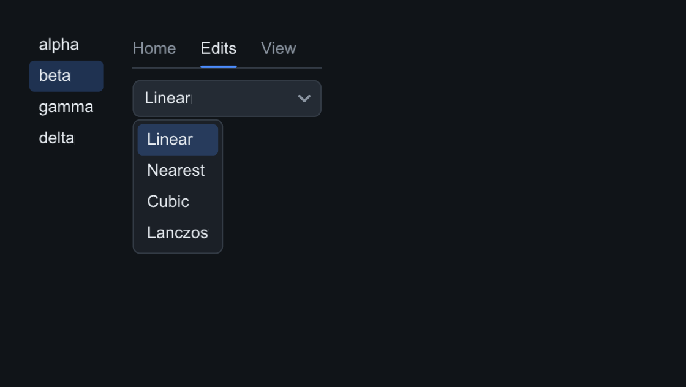

### Panel, Row, Column, Spacer, Divider

Layout is immediate-mode in spirit but retained in the tree: `Column` and
`Row` stack children with `set_gap` and `set_padding`, distribute extra space
to children that expand, and align cross-axis with `set_cross`
(`CrossMode::Stretch`, `Start`, `Center`). `Panel` is a bordered, rounded
container; `Spacer` soaks up remaining space; `Divider` draws a rule.

```cpp
auto& panel = root.add<Panel>();
panel.set_padding(14).set_gap(10);
panel.set_radius(10);
panel.add<Label>("Panel — a bordered container");
auto& top = panel.add<Row>();
top.add<Label>("left");
top.add<Spacer>();          // pushes "right" to the far edge
top.add<Label>("right");
panel.add<Divider>();
auto& bot = panel.add<Row>();
bot.set_gap(16);
bot.add<Checkbox>("Snap", true);
bot.add<Checkbox>("Grid", false);
```

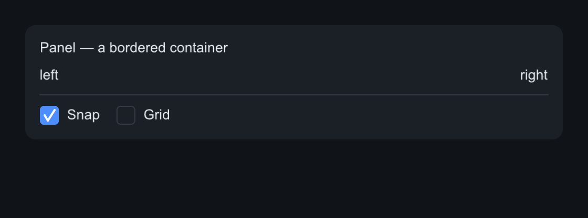

### Expander, Accordion, Splitter

`Expander` shows/hides its subtree behind a titled header
(`set_open`, `on_toggle(void(bool))`) — closed children get zero frames and
skip hit-testing.

`Accordion` stacks Expander sections. `add_section(title, open = false)`
returns the section's `Expander` (itself a `Container`) — fill it with rows,
sliders, whatever the group needs. By default the accordion is **exclusive**:
opening one section closes the others, so at most one is expanded;
`set_exclusive(false)` lets every section stand open.

```cpp
auto& acc = root.add<slikui::Accordion>();
acc.set_gap(6);
auto& shape = acc.add_section("Shape", /*open=*/true);  // open by default
shape.set_gap(8);
shape.add<Dropdown>().set_items({"Cube", "Sphere", "Torus"});
auto& material = acc.add_section("Material");
material.set_gap(8);
material.add<Slider>(0.f, 1.f);          // roughness
material.add<Slider>(0.f, 1.f);          // metallic
```

`Splitter` divides two children with a draggable divider
(`set_fraction` 0–1, `on_change(void(float))`; construct with `true` for a
horizontal divider / stacked panes).

```cpp
auto& exp = root.add<Expander>("More options");
exp.set_open(true);
exp.add<Column>().set_gap(8)
    .add<Checkbox>("Compress", true);
auto& split = root.add<Splitter>();
split.set_fraction(0.45f);
split.add<Panel>().set_padding(12).add<Label>("left pane");
split.add<Panel>().set_padding(12).add<Label>("right pane");
```

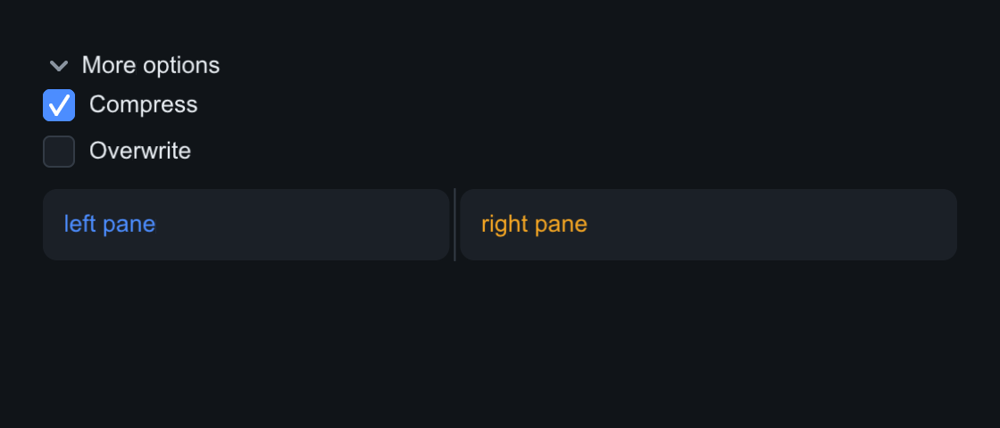

### Image

Decodes PNG/JPEG via vendored stb_image. Feed it pixels you already have
(`set_pixels`), a file (`set_file`), or an encoded memory blob (`set_memory`).
`set_fit` chooses how the source maps into the widget rect: `Stretch`,
`Contain` (letterbox), `Cover` (crop). Textures upload through the same
`TexUpload` channel as the font atlas, so every backend gets it for free.

```cpp
auto& cell = row.add<Column>();
cell.set_gap(6).set_cross(CrossMode::Center);
cell.add<Image>("gradient").set_pixels(64, 48, grad_rgba)
    .set_size(150, 110).set_fit(Image::Fit::Contain);
cell.add<Label>("Contain").set_color(ctx.theme().text_dim);
```

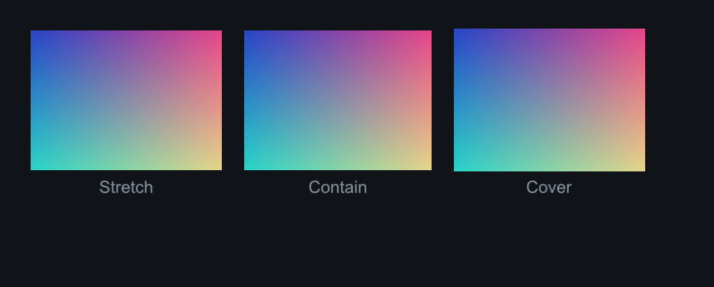

### Tooltips

Any widget can carry a tooltip with `set_tooltip`. It appears after a ~0.6 s
hover delay and dismisses on mouse-away or click. Because setters return
`Widget&` (no deducing-this before C++23), base-class setters like
`set_tooltip` must come **last** in a chain.

```cpp
row.add<Button>("Save");
row.add<Button>("Delete all")
    .set_variant(Button::Variant::Danger)
    .set_tooltip("Removes every item — this cannot be undone");
```

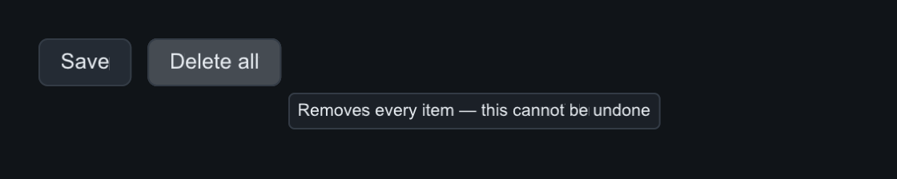

### Theming

`ctx.theme()` is a plain struct: palette (`background`, `surface`,
`surface_alt`, `border`, `text`, `text_dim`, `accent`, `accent_text`,
`danger`, `success`, `warning`), metrics (`base_font_px`, `radius`,
`border_width`, `gap`, font sizes, `scale`), and derive helpers (`hover()`,
`press()`, `dimmed()`). Eight presets ship with the library — each varies the
palette *and* the corner radius, so every scheme gets its own character:
Dark, Light, Nord, Dracula, Gruvbox, Mocha (Catppuccin), Solarized, and
Phosphor (green CRT terminal, square corners).

```cpp
ctx.theme() = slikui::Theme::nord();              // simplest — resets scale too
slikui::use_theme(ctx.theme(), slikui::Theme::mocha()); // keeps your `scale`
slikui::apply_preset(ctx.theme(), 5);             // by index, wraps around

// Build a picker from the registry:
for (const auto& p : slikui::theme_presets()) names.push_back(p.name);
header.add<Dropdown>().set_items(names)
    .on_select([&](size_t i) { slikui::apply_preset(ctx.theme(), i); });
```

Set `theme().scale` for HiDPI: layout stays in logical points, each sink maps
them to device pixels (`sink.set_scale()`). Anything not in the preset list is
one struct away — assign the palette fields by hand.

```cpp
ctx.theme().scale = 2.f;          // retina-class density
sink.set_scale(ctx.theme().scale);
ctx.theme().accent = slikui::Color::from_hex(0xE060B0); // your brand
```

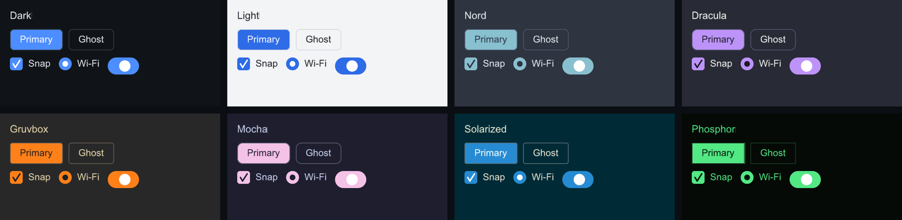

---

## Building the demos

```
cmake -S . -B build
cmake --build build -j
ctest --test-dir build          # golden-image pixel checks included
./build/examples/03_gallery/slikui_gallery
./build/examples/04_glfw_opengl     # 3D shape viewer: orbit + zoom + accordion panel
./build/examples/04_glfw_software   # same UI, CPU-rasterized scene
```

Examples: `01_hello` (GLFW+GL), `02_raw_pixels` (headless, writes a PPM),
`03_gallery` (all widgets), `04_glfw_opengl`, `04_glfw_software` (CPU
rasterizer in a window). `04_glfw_opengl` renders a lit reference shape
(cube, sphere or torus — pick it in the **Shape** section) over a procedural
sky, and edits material, environment, light and camera state live from an
accordion control panel; drag to orbit, scroll to zoom.

Regenerate the images above with:

```
clang++ -std=c++20 -Iinclude tools/components_capture.cpp -o /tmp/ccap
/tmp/ccap docs/images            # writes PPMs
for f in docs/images/*.ppm; do python3 tools/ppm2png.py "$f" "${f%.ppm}.png"; done
```

## Documentation

- `docs/architecture.md` — how the pieces fit together.
- `docs/backend-contract.md` — writing a new graphics-API backend.
- [`python/README.md`](python/README.md) — the Python bindings (`slikui`):
  install, widgets, events, and implementing your own renderer.

## Roadmap

Toasts, tree/table views, resizable floating windows, per-widget style
overrides, dirty-region relayout.

MIT licensed. stb libraries are public domain.
