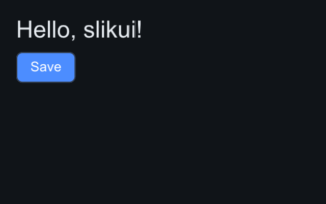

# Getting started — Python

Install the bindings — pip picks the wheel matching your OS, CPU and Python
(3.10–3.14 on Linux x86_64/aarch64, macOS arm64, Windows x64); without a
wheel, pip builds from the sdist (needs a C++20 compiler):

```sh
pip install slikui-python
```

Headless and testable by default: the software rasterizer renders into a
`numpy` framebuffer — no window, no GPU, no event loop required.

## A first frame

```python
import slikui

ui = slikui.App(320, 200)                     # Target + Sink + Context + font
root = ui.set_root(slikui.Column, padding=16, gap=8)
root.add(slikui.Label, "Hello, slikui!", font_size=26)
root.add(slikui.Button, "Save", variant=slikui.ButtonVariant.Primary)

ui.tick(0.0, 1 / 60)                          # layout + animation
frame = ui.render()                           # zero-copy (H, W) uint32 ndarray

slikui.save_image(frame, "hello.png")
```



`App` is also a context manager; `close()` destroys the tree and releases the
Python callbacks it holds so shutdown is leak-free:

```python
with slikui.App(320, 200) as ui:
    ...
```

## Driving it with events

Build real `slikui.Event` values and push them through the real dispatch
path — this is exactly how the simulated-input tests work:

```python
ui.handle(slikui.mouse_press((60, 40)))   # click through hit-testing
ui.handle(slikui.text_input("h"))         # into the focused TextField
ui.handle(slikui.scroll(pos, (0, -1)))    # wheel, "ctrl+shift" mods supported
```


## Building from source

The C++ side is header-only, nothing to link:

```sh
pip install -e .                  # editable, into your venv — from the repo root
python -m pytest python/tests     # widgets, events, custom widgets, renderer parity
python -m slikui.examples.hello   # shipped demos: writes hello.png in CWD
python -m slikui.examples --list  # the whole shipped suite
```

Interactive demos (optional deps): `pip install glfw PyOpenGL`, then
`python python/examples/glfw_demo.py` — the software rasterizer blended over
a GL scene — and `python python/examples/showcase.py` (every widget live;
`--smoke out.png` runs it headless and its transcript is byte-identical to
the C++ twin's).

The shipped suite has a live mode too: add `--window` to any example and the
same demo opens in a real GLFW window with mouse and keyboard wired through
the real event dispatch path — nothing about the headless modes changes.

```sh
pip install "slikui-python[demo]"           # glfw + PyOpenGL (quotes matter in zsh)
python -m slikui.examples.hello --window
python -m slikui.examples.gallery --window   # scrolls; click around
python -m slikui.examples.events --window    # the probe logs your input live
python -m slikui.examples.paint --window     # scrub the meter, toggle, watch it run
python -m slikui.examples.controls --window  # knob, XY pad, joystick
python -m slikui.examples.keyboard --window  # focus tour and Snake
python -m slikui.examples.window --window    # a small live app
```

All eight, with screenshots: [Python examples](../guide/examples.md).

The window host is a thin translation layer (GLFW callbacks → `slikui`
events → premultiplied blit of the core's framebuffer); the demos stay
importable without glfw or PyOpenGL, since the host is imported lazily.

## Next

- [Python examples](../guide/examples.md) — the shipped demo suite and its
  four modes (headless, smoke, docs capture, live window)
- [Python bindings reference](../reference/python-bindings.md) — App, events,
  your own renderer, custom widgets
- [Widget index](../reference/index.md) — everything you can put on screen
- [Theming](../guide/theming.md) — presets and HiDPI scale
