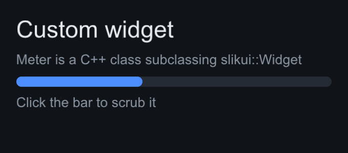
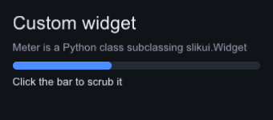

# Custom widgets

Both languages can define new widgets against the same core contract. The
C++ core lays out, paints, hit-tests and dispatches events to your class —
in Python this works through a nanobind trampoline, and it is pixel-identical
to the C++ path (there is a parity test against the C++ `Swatch`).

## The widget contract

A widget implements whichever of these it needs:

| Method | Role |
|--------|------|
| `measure(const Constraints&)` | intrinsic size under bounds; return clamped `Size` |
| `arrange(const Rect&)` | assign own absolute frame + children (default assigns `bounds`) |
| `paint(const PaintEnv&)` | append draw commands to `env.list` |
| `on_event(const Event&)` | return `true` to consume an event |
| `tick(Time)` | animation / per-frame state |
| `focusable()`, `expands_main()`, `stretch_cross()` | opt-in layout/focus behavior |
| `clip_rect()` | container clipping for its subtree |

Frames are absolute framebuffer coordinates; `paint_tree`, hit-testing and
`tick_tree` all recurse through `children`, so a wrapper widget that only
overrides `measure`/`arrange` keeps its subtree fully live.

Painting emits into `env.list` (`rect`, `hollow_rect`, `line`, `circle`,
`image`, `glyph`, clip stack) using `env.theme` colors — the same
[DrawList commands](backends.md#drawlist-semantics) every backend receives.

## C++ example

Define the widget, implement `measure`/`paint`/`on_event`, add it like any
other. `Meter` below is the C++ twin of the Python example further down —
the capture tool renders the identical tree: same 10 px measure, same paint
math, same click-to-scrub event. State is a private `float` in C++ and a
plain attribute in Python; the trampoline forwards the protocol calls either
way.

```cpp
class Meter : public slikui::Widget {
public:
    explicit Meter(float value = 0.f) : value_(value) {}

    Size measure(const Constraints& c) override { return c.clamp({0.f, 10.f}); }

    void paint(const slikui::PaintEnv& env) const override {
        env.list.rect(bounds, env.theme.surface_alt, bounds.h / 2);
        if (value_ > 0.f)
            env.list.rect({bounds.x, bounds.y, bounds.w * value_, bounds.h},
                          env.theme.accent, bounds.h / 2);
    }

    bool on_event(const slikui::Event& e) override {
        // Click to the left/right of the fill to move it.
        if (e.type == slikui::Event::Type::MousePress && bounds.contains(e.pos)) {
            value_ = std::clamp((e.pos.x - bounds.x) / bounds.w, 0.f, 1.f);
            return true;
        }
        return false;
    }

private:
    float value_ = 0.f;
};

auto& title = root.add<slikui::Label>("Custom widget");
title.set_font_size(26);
root.add<slikui::Label>("Meter is a C++ class subclassing slikui::Widget")
    .set_color(ctx.theme().text_dim);
root.add<Meter>(0.4f);                     // stretch_cross() defaults to true
root.add<slikui::Label>("Click the bar to scrub it")
    .set_color(ctx.theme().text_dim);
```



`examples/05_showcase` ships two production custom widgets: `Fill` (expands
on the main axis and hands its whole area to a single child) and
`LevelMeter` (LED bar with click/drag scrubbing, peak-hold and a warning
gradient).

## Python example

Subclass `slikui.Widget`, implement `measure` / `paint` / `on_event` (plus
opt-in `tick`, `stretch_cross`, `expands_main`, `focusable`, `widget_type`):

```python
class Meter(slikui.Widget):
    """A horizontal bar that fills as `value` (0..1) approaches 1."""

    def __init__(self, value=0.0):
        super().__init__()  # required
        self.value = value

    def measure(self, constraints):
        return constraints.clamp(slikui.Size(0, 10))

    def paint(self, env):
        env.list.rect(self.bounds, env.theme.surface_alt, self.bounds.h / 2)
        if self.value > 0:
            fill = slikui.Rect(self.bounds.x, self.bounds.y,
                               self.bounds.w * self.value, self.bounds.h)
            env.list.rect(fill, env.theme.accent, self.bounds.h / 2)

    def on_event(self, event):
        # Click to the left/right of the fill to move it.
        if event.type == slikui.EventType.MousePress and self.bounds.contains(event.pos):
            v = (event.pos.x - self.bounds.x) / self.bounds.w
            self.value = max(0.0, min(v, 1.0))
            return True
        return False
```

Add instances with `container.add_widget(obj)` or
`container.add(Meter, 0.4)`; a custom root is `context.set_root_widget(...)`.
Python state lives in ordinary instance attributes.



## Rules and gotchas

- Python subclasses **must call `super().__init__()`**.
- Subclassing the *bound* C++ widget types (`Column`, `Row`, ...) is
  rejected — build layouts from Python code instead. Only `slikui.Widget`
  subclasses are the extension seam.
- Callbacks into Python must outlive the tree: `App.close()` (context manager
  exit, `atexit`) releases them; see
  [Python bindings](../reference/python-bindings.md).
- The full worked example lives at `python/examples/custom_widget.py`
  (run it — it writes `docs/images/custom_widget.png`, the image above) and
  the interactive twin in `python/examples/showcase.py`.
