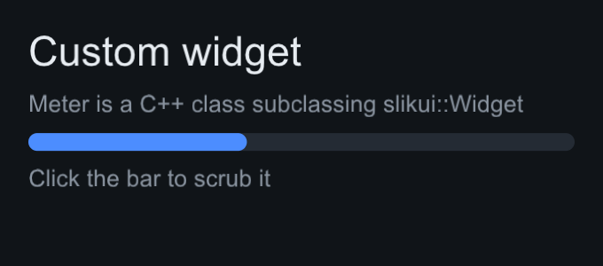
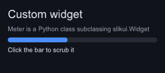

# Custom widgets

Both languages can define new widgets against the same core contract. The
C++ core lays out, paints, hit-tests and dispatches events to your class -
in Python this works through a nanobind trampoline, and it is pixel-identical
to the C++ path (there is a parity test against the C++ `Swatch`).

## The widget contract

A widget implements whichever of these it needs:

| Method | Role |
|--------|------|
| `measure(const Constraints&)` | intrinsic size under bounds; return clamped `Size` |
| `arrange(const Rect&)` | assign own absolute frame + children (default assigns `bounds`) |
| `paint(const PaintEnv&)` | append draw commands to `env.list` (before the children) |
| `paint_over(const PaintEnv&)` | draw on top of the children (decorations, overlays) |
| `on_event(const Event&)` | return `true` to consume an event |
| `tick(Time)` | animation / per-frame state |
| `focusable()`, `expands_main()`, `stretch_cross()` | opt-in layout/focus behavior |
| `clip_rect()` | container clipping for its subtree (painting and hit-testing) |
| `child_clip_rect(const Widget&)` | C++ only: extra clip for one child's subtree (e.g. per pane) |
| `scroll_into_view(const Rect&)` | C++ only: scrolling containers bring a keyboard-focused descendant into view |
| `attached(Context&)` | called once when the widget joins a context |
| `theme_changed()` | the context's theme changed (UI scale/zoom, preset, palette): drop cached text layouts or theme-derived colors |

Layout runs in `Context::tick` (Python `app.tick()`), not in `render`: bounds
are zero, and `context()` is null, until the first tick after a widget is
added. What `on_event` receives - every mouse button, synthesized
`Click`/`DoubleClick`, `MouseEnter`/`MouseLeave`, `FocusGained`/`FocusLost`,
`KeyRelease` - and the mouse-capture drag idiom are in
[Input & events](input-events.md#routing-rules).

Frames are absolute framebuffer coordinates; `paint_tree`, hit-testing and
`tick_tree` all recurse through `children`, so a wrapper widget that only
overrides `measure`/`arrange` keeps its subtree fully live.

Painting emits into `env.list` (`rect`, `hollow_rect`, `line`, `circle`,
`image`, `glyph`, clip stack) using `env.theme` colors - the same
[DrawList commands](backends.md#drawlist-semantics) every backend receives.

## Drawing text

`env.text` draws a string at a point and `env.text_in` draws it inside a
rect. With no options you get the theme's body font, size and text color;
pass only what differs. Both return the rect the text occupies, so you can
place what comes next. Sizes are logical px - theme scale is handled for
you.

=== "C++"

    ```cpp
    void paint(const slikui::PaintEnv& env) const override {
        using slikui::TextAlign, slikui::TextVAlign, slikui::TextOverflow;
        env.text({bounds.x, bounds.y}, "Hello");
        env.text_in(bounds, "42%", {.size = 20, .bold = true,
                                    .align = TextAlign::Center,
                                    .valign = TextVAlign::Middle});
        env.text_in(cell, name, {.overflow = TextOverflow::Ellipsis});

        slikui::Rect r = env.text({x, y}, "42", {.size = 24, .bold = true});
        env.text({r.right(), y}, "%", {.size = 14});    // follows the number
    }

    Size measure(const slikui::Constraints& c) override {
        return c.clamp(ctx->text_size("42%", {.size = 20, .bold = true}));
    }
    ```

=== "Python"

    ```python
    def paint(self, env):
        env.text(slikui.Vec2(self.bounds.x, self.bounds.y), "Hello")
        env.text_in(self.bounds, "42%", size=20, bold=True,
                    align="center", valign="middle")
        env.text_in(cell, name, overflow="ellipsis")

        r = env.text(slikui.Vec2(x, y), "42", size=24, bold=True)
        env.text(slikui.Vec2(r.x + r.w, y), "%", size=14)

    def measure(self, constraints):
        return constraints.clamp(self.context.text_size("42%", size=20, bold=True))
    ```

The options (`slikui::TextOpts`), all defaulting to the theme:

| Option | Meaning |
|--------|---------|
| `font` | family or role: `"body"` (default), `"heading"`, `"mono"`, or a name passed to `add_font` |
| `size` | logical px; 0 = `theme.base_font_px` |
| `color` | alpha 0 / `None` = `theme.text` |
| `bold`, `italic`, `underline`, `strike` | style; missing faces are synthesized |
| `align` | `Left` / `Center` / `Right`: which part of the text sits on the point, or alignment inside the rect |
| `valign` | `Top` / `Middle` / `Baseline` / `Bottom` |
| `wrap` | wrap to the rect width (`text_in`) or `max_width` (`text`) |
| `max_width` | `text` only: the available width for `wrap` and `overflow` |
| `overflow` | `Visible`, `Clip` to the available width, or `Ellipsis` (single line) |

In C++ the options are a struct, so designated initializers must follow the
order of the table (`{.size = 20, .bold = true}`, not
`{.bold = true, .size = 20}`); a reusable style is just a
`static const slikui::TextOpts`. Python takes them as keyword arguments, and
`align` / `valign` / `overflow` also accept lowercase names (`"center"`).
`ctx->text_metrics(opts)` gives ascent, descent and line height for laying
out lines yourself.

`env.text` lays out on every call, and the context caches the result, so
drawing the same strings every frame is cheap. For interactive text, keep a
`TextBlock` instead: it is laid out once, drawn with `env.draw(block, pos)`,
and answers `hit_test(point)`, `caret_rect(index)` and
`selection_rects(start, end)` (byte offsets in C++, str indices in Python).

```cpp
slikui::TextBlock block = ctx->text_layout(paragraph, /*wrap_width=*/240, {.font = "mono"});
size_t caret = block.hit_test(click_pos - top_left);
```

Worked versions of all of this - a tag sized by `text_size`, a stat card,
ellipsis vs wrapping, and drag-to-select on a `TextBlock` - are in the
`text` example (`python -m slikui.examples.text --window`) and its C++
twin `examples/07_text`; see [Python examples](examples.md#text).

## C++ example

Define the widget, implement `measure`/`paint`/`on_event`, add it like any
other. `Meter` below is the C++ twin of the Python example further down -
the capture tool renders the identical tree: same 10 px measure, same paint
math, same click-to-scrub event. State is a private `float` in C++ and a
plain attribute in Python; the trampoline forwards the protocol calls either
way.

```cpp
class Meter : public slikui::Widget {
public:
    explicit Meter(float value = 0.f) : value_(value) {}

    Size measure(const Constraints& c) override { return c.clamp({0.f, 10.f}); }

    void paint(const slikui::PaintEnv& env) const override {
        env.list.rect(bounds, env.theme.surface_alt, bounds.h / 2);
        if (value_ > 0.f)
            env.list.rect({bounds.x, bounds.y, bounds.w * value_, bounds.h},
                          env.theme.accent, bounds.h / 2);
    }

    bool on_event(const slikui::Event& e) override {
        // Click to the left/right of the fill to move it.
        if (e.type == slikui::Event::Type::MousePress && bounds.contains(e.pos)) {
            value_ = std::clamp((e.pos.x - bounds.x) / bounds.w, 0.f, 1.f);
            return true;
        }
        return false;
    }

private:
    float value_ = 0.f;
};

auto& title = root.add<slikui::Label>("Custom widget");
title.set_font_size(26);
root.add<slikui::Label>("Meter is a C++ class subclassing slikui::Widget")
    .set_color(ctx.theme().text_dim);
root.add<Meter>(0.4f);                     // stretch_cross() defaults to true
root.add<slikui::Label>("Click the bar to scrub it")
    .set_color(ctx.theme().text_dim);
```



`examples/05_showcase` ships two production custom widgets: `Fill` (expands
on the main axis and hands its whole area to a single child) and
`LevelMeter` (LED bar with click/drag scrubbing, peak-hold and a warning
gradient).

## Python example

Subclass `slikui.Widget`, implement `measure` / `paint` / `on_event` (plus
opt-in `tick`, `stretch_cross`, `expands_main`, `focusable`, `arrange`,
`clip_rect`, `paint_over`, `attached`, `theme_changed`, `widget_type`). Widgets read
`self.bounds`, `self.focused` and `self.context` (for
`capture_mouse`/`release_mouse`/`set_focus`), and can call
`self.request_focus()` and `self.set_cursor(...)`:

```python
class Meter(slikui.Widget):
    """A horizontal bar that fills as `value` (0..1) approaches 1."""

    def __init__(self, value=0.0):
        super().__init__()  # required
        self.value = value

    def measure(self, constraints):
        return constraints.clamp(slikui.Size(0, 10))

    def paint(self, env):
        env.list.rect(self.bounds, env.theme.surface_alt, self.bounds.h / 2)
        if self.value > 0:
            fill = slikui.Rect(self.bounds.x, self.bounds.y,
                               self.bounds.w * self.value, self.bounds.h)
            env.list.rect(fill, env.theme.accent, self.bounds.h / 2)

    def on_event(self, event):
        # Click to the left/right of the fill to move it.
        if event.type == slikui.EventType.MousePress and self.bounds.contains(event.pos):
            v = (event.pos.x - self.bounds.x) / self.bounds.w
            self.value = max(0.0, min(v, 1.0))
            return True
        return False
```

Add instances with `container.add_widget(obj)` or
`container.add(Meter, 0.4)`; a custom root is `context.set_root_widget(...)`.
Python state lives in ordinary instance attributes.



## Rules and gotchas

- Python subclasses **must call `super().__init__()`**.
- Besides `slikui.Widget`, you can subclass `Panel`, `Column` and `Row`:
  overrides dispatch, and `super()` calls reach the built-in behaviour
  (`super().paint(env)` draws the panel, `super().measure(c)` lays out the
  children). Other bound types (`Slider`, `Button`, ...) have no override
  seam - overriding `on_event`, `paint`, ... on them raises `TypeError` at
  class creation. To decorate one of those, wrap it: delegate
  `measure`/`arrange` to the child and draw in `paint_over` (`LimitSlider`
  in `slikui.examples.controls`).
- Draw text with `env.text` / `env.text_in` (see
  [Drawing text](#drawing-text)); `Label` widgets beside a custom widget
  still work for captions.
- Keep the wrappers `add()` returns (`self.slider = self.add(slikui.Slider)`)
  and capture them in callbacks freely. They are views of widgets the tree
  owns: valid until the tree drops the widget (`remove`, `App.close()`, or
  its container being destroyed). Using one after that raises `TypeError`.
- Callbacks into Python must outlive the tree: `App.close()` (context manager
  exit, `atexit`) releases them; see
  [Python bindings](../reference/python-bindings.md).
- The full worked example ships in the wheel: `slikui/examples/paint.py`
  (run `python -m slikui.examples.paint --docs-image custom_widget
  docs/images/custom_widget.png` to regenerate the image above; the demo
  page has Sparkline, RadialGauge, ClockFace and a layout-bounds wrapper
  beside the Meter). The interactive twin is `python/examples/showcase.py`.
