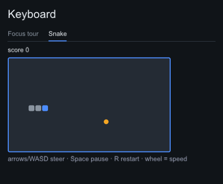
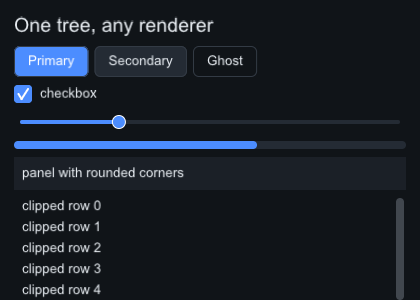

# Python examples

The wheel ships a curated demo suite as `slikui.examples` — the usage
reference that matches the slikui version you installed. Every example
file runs on its own (copy it anywhere and run `python controls.py`),
checks itself, and drives the real event dispatch path. Every widget quoted
on these pages is self-contained: paste the block into your own file and it
runs, imports included.

## Run them

The examples ship in the wheel, so there is nothing to download:

```sh
pip install slikui-python                       # headless: renders to PNG
pip install "slikui-python[demo]"               # + glfw and PyOpenGL for live windows

python -m slikui.examples.controls --window     # open one live (any name below)
python -m slikui.examples.controls              # or headless: writes ./controls.png
```

The quotes around `"slikui-python[demo]"` matter in zsh, the macOS default
shell. The suite itself:

```sh
python -m slikui.examples --list        # what's shipped
python -m slikui.examples --where       # the directory: read the sources
python -m slikui.examples --contract    # what a custom widget receives, measured live
python -m slikui.examples --smoke all   # scripted self-check of every example
```

`slikui-examples` is the same launcher as a command.

`help(slikui.examples)` prints the index and the custom-widget contract in
one screen.

## The suite

| # | Example | Shows |
|---|---|---|
| 01 | `hello` | first frame, minimal tree, headless render |
| 02 | `gallery` | widget survey — most built-in widgets in one tall page |
| 03 | `events` | event anatomy: `EventProbe` narrates every event it receives |
| 04 | `paint` | drawing cookbook: Meter, Sparkline, RadialGauge, ClockFace, BoundsDebug |
| 05 | `controls` | Knob, XYPad, Joystick with full mouse + keyboard; LimitSlider decorates a built-in |
| 06 | `keyboard` | focus traversal and rings, global shortcuts, Snake |
| 07 | `renderer` | the render contract: two renderers, identical pixels, and your own |
| 08 | `window` | a live app in a GLFW window (the same tour runs headless) |

## See them

The frames below are the examples' own `--smoke` output — post-interaction
frames captured by the same scripted pass CI runs:







## Every example has the same four modes

```sh
python -m slikui.examples.paint              # headless render -> paint.png
python -m slikui.examples.paint --png out.png
python -m slikui.examples.paint --smoke      # scripted interaction pass, self-checking
python -m slikui.examples.paint --window     # live GLFW window (needs the demo extra)
```

- **Default** — render one frame to `./NAME.png`; no display, no glfw.
- **`--smoke`** — synthetic input (click, drag, scroll, keys) against a fixed
  clock; asserts and prints a transcript. This is what CI runs, so the
  examples double as the wheel's acceptance test.
- **`--window`** — the same demo live: GLFW callbacks feed real events, the
  core renders into its framebuffer, and a thin premultiplied blit puts it on
  screen. Needs `pip install "slikui-python[demo]"`; the host is imported
  lazily, so the base wheel never pulls in glfw or PyOpenGL.

## EventProbe in depth

`events` is the place to start if you're writing a custom widget: it shows
what arrives and in what order — enter/leave, press/release/click,
double-click, a captured drag, focus gained/lost, key down/up. It has its
own section in
[Input & events](input-events.md#watching-events-the-shipped-eventprobe-demo).

## Custom widgets in depth

`paint` is the worked drawing example — measure/arrange/paint, direct
DrawList drawing, tick animation, hover via `MouseLeave`, and a debug
overlay drawn with `paint_over`. See [Custom widgets](custom-widgets.md) for
the guide and the screenshot-capture contract (`--docs-image`).


## Extended controls

`controls` builds three controls the built-in set doesn't have. Every drag
uses one idiom — capture the mouse on press, release on release, cancel on
`FocusLost` — so drags survive the pointer leaving the widget:

--8<-- "includes/examples/knob.md"

`Joystick` holds a key set from `KeyPress`/`KeyRelease`, so WASD pushes
the stick only while held; the stick springs back in `tick`:

--8<-- "includes/examples/joystick.md"

`LimitSlider` decorates the built-in `Slider`, which Python can't subclass:
it wraps one, delegates layout, and draws its marks in `paint_over`, after
the Slider has painted:

--8<-- "includes/examples/limitslider.md"

## Keyboard

`keyboard` covers focus traversal (each chip draws its own focus ring and
reports `FocusGained`/`FocusLost`), a global <kbd>Ctrl</kbd>+<kbd>R</kbd>
shortcut, and a whole game in one widget:

--8<-- "includes/examples/snake.md"


## Your own renderer

`renderer` proves the C++ and pure-Python renderers produce identical
frames, then shows the seam a third-party renderer plugs into:

--8<-- "includes/examples/tracesink.md"

## A live window

`window` runs a small tour in a real window; its root widget sees every
mouse move that bubbles up unconsumed:

--8<-- "includes/examples/pointerroot.md"

Any windowing toolkit works the same way: translate its input into
`slikui.mouse_press` / `key_press` / `text_input` (and friends) events for `app.handle`, call
`app.tick` then `app.render` each frame, and show the returned
`(H, W)` uint32 array.
