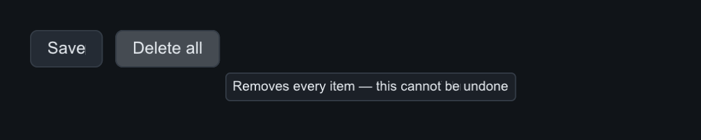

# Input & events

Backends translate native events into one `slikui::Event` vocabulary;
`Context::handle` routes them. Your application code rarely constructs events
by hand in C++ — the [window layer](backends.md) does it — but the vocabulary
is the same on every platform and it is exactly what you translate (or
synthesize in tests) yourself.

## The event vocabulary

Hosts send raw input:

| Event | Carries | Notes |
|-------|---------|-------|
| `MouseMove` | `pos`, `delta`, `mods` | logical points, y-down |
| `MousePress` / `MouseRelease` | `button`, `pos`, `mods`, `clicks` | any button; routed through hit-testing |
| `Scroll` | `pos`, `scroll`, `mods` | wheel ticks |
| `KeyPress` / `KeyRelease` | `key`, `mods`, `repeat` | focus-routed; `repeat` marks auto-repeat presses |
| `TextInput` | `codepoint` | Unicode scalar, to the focused widget |
| `FocusLost` | — | the app lost focus: cancels drags, closes popups |
| `FrameResize` | `pos` = pixel size | converted to the logical frame |

The Context synthesizes these for widgets (hosts never send them):

| Event | When | Delivered to |
|-------|------|--------------|
| `Click` | press + release on the same widget, any button; `clicks` = 1, 2, 3… | the pressed widget, bubbling |
| `DoubleClick` | after the `Click` whose `clicks == 2` | the pressed widget, bubbling |
| `MouseEnter` / `MouseLeave` | the pointer entered / left the widget *and its descendants* | that widget only |
| `FocusGained` / `FocusLost` | keyboard focus moved (or the app lost focus mid-drag) | that widget only |

`clicks` counts presses of the same button within
`Event::kMultiClickTime` (0.4 s, Python `slikui.Event.MULTI_CLICK_TIME`) and
`kMultiClickSlop` (4 px) of the previous one. Events carry no timestamps, so
the timing is measured on the Context's tick clock: headless tests must
advance ticks between clicks.

=== "C++"

    ```cpp
    // You normally receive these from the window layer; synthesizing works
    // the same way (headless tests do exactly this):
    ctx.handle(slikui::Event::mouse_press({60, 40}));
    ctx.handle(slikui::Event::text_input('h'));
    ```

=== "Python"

    ```python
    ui.handle(slikui.mouse_press((60, 40)))   # click through hit-testing
    ui.handle(slikui.text_input("h"))         # into the focused TextField
    ui.handle(slikui.scroll(pos, (0, -1)))    # wheel, "ctrl+shift" mods supported
    ```

Python event constructors (`slikui.mouse_press`, `text_input`, `scroll`,
`key_press`, ...) build real `Event` values that drive the real dispatch path
— the simulated-input tests use them.


## Routing rules

1. **Hit-testing** — the deepest visible widget containing the pointer wins.
2. **Bubble up** — the event dispatches up the parent chain until a widget
   consumes it (widgets return `true` from `on_event`). Enter/Leave and
   FocusGained/FocusLost never bubble.
3. **Every button** — left, middle and right presses all reach widgets
   (built-ins act on the left button only). A right press on a widget with a
   context menu opens the menu instead; that press and its release are not
   delivered.
4. **Focus** — key/text events go to the focused widget; with nothing
   focused, key events go to the hovered widget. A left click focuses the
   nearest focusable ancestor of the hit; <kbd>Tab</kbd> /
   <kbd>Shift</kbd>+<kbd>Tab</kbd> cycle focusables in tree order;
   <kbd>Escape</kbd> clears focus. Tab, Escape and shortcut chords are
   consumed by the Context. A `KeyRelease` is delivered only for a press the
   tree received.
5. **Popups** — clicking outside a popup dismisses it. Popups are owned by
   the context and destroyed at the end of `handle`, never during dispatch.
6. **Mouse capture** — a widget calls `ctx->capture_mouse(this)` (Python:
   `self.context.capture_mouse(self)`) on press to receive every following
   move and the release, even outside its bounds, and `release_mouse` when
   done. If the app loses focus mid-drag, the capturing widget receives
   `FocusLost` — cancel the drag there.

## Watching events: the shipped EventProbe demo

`slikui.examples.events` is a custom widget whose whole job is narrating
every event it receives into a LogView — enter/leave, press/release/click,
double-click, a captured drag that leaves the widget, scroll, the
right-click context menu, focus gained/lost, focus-routed keys (press and
release) and text. Its `--smoke` pass drives the whole vocabulary
synthetically and asserts each event arrives, in order, exactly where the
routing rules above say it should. The probe is also the reference drag
idiom — capture on press, release on release, cancel on `FocusLost`:

--8<-- "includes/examples/eventprobe.md"

Run it: `python -m slikui.examples.events` (headless screenshot) or
`--smoke` for the scripted pass. For a one-screen summary measured on your
installed build, run `python -m slikui.examples --contract`.

## Menus, context menus and shortcuts

`MenuBar`/`Menu` are built once and opened as borrowed popups; any widget can
carry a right-click menu; global accelerators run before widget dispatch (a
modifier is required, so typing never triggers one). Full details and code:
[Menus & toolbars](../reference/widgets-menus.md).

=== "C++"

    ```cpp
    viewport.set_context_menu(&view_menu);          // right-click
    ctx.add_shortcut(slikui::Key::R, slikui::ModCtrl, render_fn);
    ```

=== "Python"

    ```python
    viewport.set_context_menu(view_menu)            # right-click
    ctx.add_shortcut(slikui.Key.R, slikui.mods("ctrl"), render_fn)
    ```


## Clipboard

`TextField`/`TextArea` read and write the host clipboard through
`ctx.set_clipboard_source` / `ctx.set_clipboard_sink`. The GLFW backend wires
the system clipboard; without a host the Ctrl/Cmd+A/C/X/V shortcuts are
silent no-ops.

## Tooltips

Any widget carries a tooltip with `set_tooltip("...")`. It appears after a
~0.6 s hover delay and dismisses on mouse-away or click. Because setters
return `Widget&` (no deducing-this before C++23), base-class setters like
`set_tooltip` must come **last** in a chain.

=== "C++"

    ```cpp
    auto& row = root.add<slikui::Row>();
    row.set_gap(10);
    row.add<slikui::Button>("Save");
    row.add<slikui::Button>("Delete all")
        .set_tooltip("Removes every item — this cannot be undone");
    ```

=== "Python"

    ```python
    row = root.add(slikui.Row, gap=10)
    row.add(slikui.Button, "Save")
    row.add(slikui.Button, "Delete all",
            tooltip="Removes every item — this cannot be undone")
    ```



## Cursor shapes

Widgets request cursor shapes with `set_cursor(slikui::Cursor::...)` — hosts
map them to system cursors via `ctx.set_cursor_host` (`GlfwWindow::attach`
does this; in Python `ctx.set_cursor_host(fn)`).
