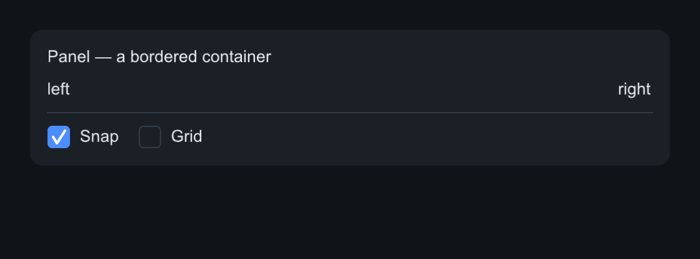
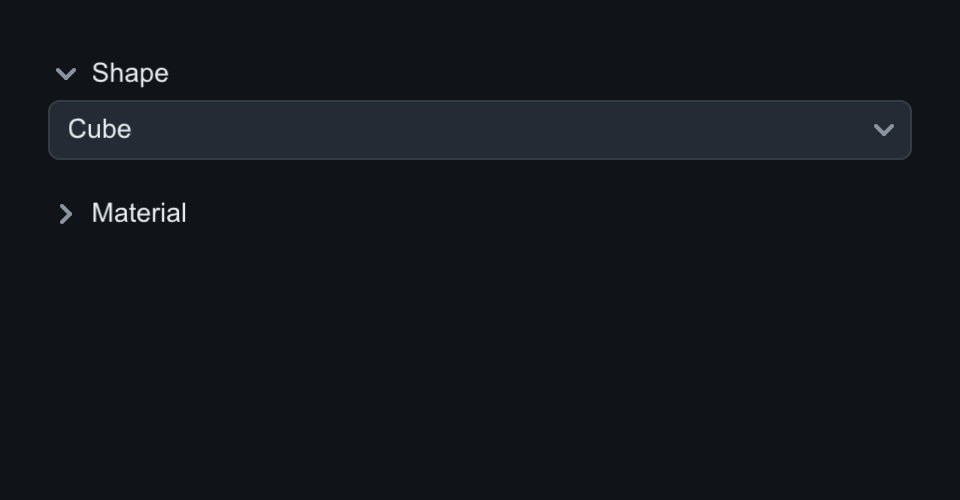
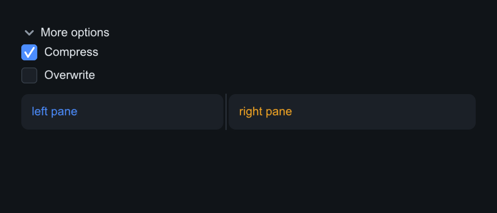

# Layout

Layout is immediate-mode in spirit but retained in the tree. `Column` and
`Row` are the workhorses; `Panel`, `Spacer` and `Divider` shape them;
`Expander`, `Accordion` and `Splitter` handle collapsible and split regions.

## Row, Column, Spacer, Divider

Both containers stack children with `set_gap` and `set_padding`, distribute
extra main-axis space to children that expand, and align cross-axis with
`set_cross` (`CrossMode::Stretch`, `Start`, `Center`). `Spacer` soaks up
remaining space — use it to push siblings to the far edge. `Divider` draws a
rule.

=== "C++"

    ```cpp
    auto& panel = root.add<slikui::Panel>();
    panel.set_padding(14).set_gap(10);
    panel.set_radius(10);
    panel.add<slikui::Label>("Panel — a bordered container");
    auto& top = panel.add<slikui::Row>();
    top.add<slikui::Label>("left");
    top.add<slikui::Spacer>();          // pushes "right" to the far edge
    top.add<slikui::Label>("right");
    panel.add<slikui::Divider>();
    auto& bot = panel.add<slikui::Row>();
    bot.set_gap(16);
    bot.add<slikui::Checkbox>("Snap", true);
    bot.add<slikui::Checkbox>("Grid", false);
    ```

=== "Python"

    ```python
    panel = root.add(slikui.Panel, padding=14, gap=10, radius=10)
    panel.add(slikui.Label, "Panel — a bordered container")
    top = panel.add(slikui.Row)
    top.add(slikui.Label, "left")
    top.add(slikui.Spacer)              # pushes "right" to the far edge
    top.add(slikui.Label, "right")
    panel.add(slikui.Divider)
    bot = panel.add(slikui.Row, gap=16)
    bot.add(slikui.Checkbox, "Snap", True)
    bot.add(slikui.Checkbox, "Grid", False)
    ```



## Panel

`Panel` is a bordered, rounded container — a `Container` that paints a
surface. `set_background`, `set_border`, `set_radius` style it; everything
else matches `Column`.

## Expander and Accordion

`Expander` shows/hides its subtree behind a titled header (`set_title`,
`set_open`, `on_toggle(void(bool))`). Closed children get zero frames and
skip hit-testing — collapsing is genuinely free.

`Accordion` stacks `Expander` sections. `add_section(title, open = false)`
returns the section's `Expander` (itself a `Container`) — fill it with rows,
sliders, whatever the group needs. By default the accordion is **exclusive**:
opening one section closes the others. `set_exclusive(false)` lets every
section stand open.

=== "C++"

    ```cpp
    auto& acc = root.add<slikui::Accordion>();
    acc.set_gap(6);
    auto& shape = acc.add_section("Shape", /*open=*/true);
    shape.set_gap(8);
    shape.add<slikui::Dropdown>().set_items({"Cube", "Sphere", "Torus"})
        .set_selected(0);
    auto& material = acc.add_section("Material");
    material.set_gap(8);
    material.add<slikui::Slider>(0.f, 1.f);   // roughness
    material.add<slikui::Slider>(0.f, 1.f);   // metallic
    ```

=== "Python"

    ```python
    acc = root.add(slikui.Accordion, gap=6)
    shape = acc.add_section("Shape", True)
    shape.set_gap(8)
    shape.add(slikui.Dropdown, items=["Cube", "Sphere", "Torus"], selected=0)
    material = acc.add_section("Material")
    material.set_gap(8)
    material.add(slikui.Slider, 0, 1)         # roughness
    material.add(slikui.Slider, 0, 1)         # metallic
    ```



## Splitter

`Splitter` divides two children with a draggable divider: `set_fraction`
(0–1), `on_change(void(float))`. Construct with `true` for a horizontal
divider / stacked panes. The capture below pairs it with an `Expander`:

=== "C++"

    ```cpp
    auto& exp = root.add<slikui::Expander>("More options");
    exp.set_open(true);
    auto& inner = exp.add<slikui::Column>();
    inner.set_gap(8);
    inner.add<slikui::Checkbox>("Compress", true);
    inner.add<slikui::Checkbox>("Overwrite", false);
    auto& split = root.add<slikui::Splitter>();
    split.set_fraction(0.45f);
    auto& l = split.add<slikui::Panel>();
    l.set_padding(12).set_radius(8);
    l.add<slikui::Label>("left pane").set_color(ctx.theme().accent);
    auto& r = split.add<slikui::Panel>();
    r.set_padding(12).set_radius(8);
    r.add<slikui::Label>("right pane").set_color(ctx.theme().warning);
    ```

=== "Python"

    ```python
    exp = root.add(slikui.Expander, open=True)
    exp.set_title("More options")
    inner = exp.add(slikui.Column, gap=8)
    inner.add(slikui.Checkbox, "Compress", True)
    inner.add(slikui.Checkbox, "Overwrite", False)
    split = root.add(slikui.Splitter, fraction=0.45)
    l = split.add(slikui.Panel, padding=12, radius=8)
    l.add(slikui.Label, "left pane").set_color(ui.ctx.theme.accent)
    r = split.add(slikui.Panel, padding=12, radius=8)
    r.add(slikui.Label, "right pane").set_color(ui.ctx.theme.warning)
    ```



## Window resizing

Layout is recomputed from scratch every tick, so resizes reflow automatically:
the backend emits a frame-resize event, `ScrollArea` clamps its offset, labels
re-wrap to the available width, and popups re-clamp to the frame. HiDPI is a
`theme().scale` change — layout stays in logical points, each sink maps them
to device pixels (see [Theming](theming.md)).

API details: [Containers](../reference/widgets-containers.md).
