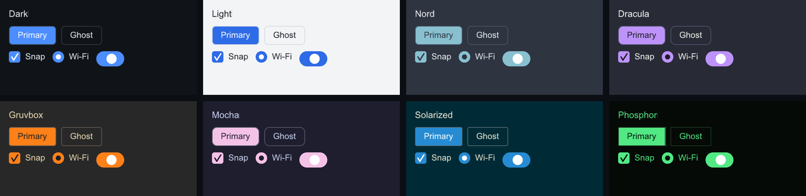

# Theming

`ctx.theme()` is a plain struct widgets read on every paint — there is no
cached styled state to invalidate. Change it any time, including per frame.

## The Theme struct

Three groups of fields:

- **Palette** — `background`, `surface`, `surface_alt`, `border`, `text`,
  `text_dim`, `accent`, `accent_text`, `danger`, `success`, `warning`.
- **Metrics** — `base_font_px`, `radius`, `border_width`, `gap`, font sizes,
  `scale`.
- **Derive helpers** — `hover()`, `press()`, `dimmed()` used by widgets for
  transitions.

## Built-in presets

Eight presets ship with the library — each varies the palette *and* the
corner radius, so every scheme gets its own character: Dark, Light, Nord,
Dracula, Gruvbox, Mocha (Catppuccin), Solarized, and Phosphor (green CRT
terminal, square corners).

=== "C++"

    ```cpp
    ctx.theme() = slikui::Theme::nord();                // simplest — resets scale too
    slikui::use_theme(ctx.theme(), slikui::Theme::mocha()); // keeps your `scale`
    slikui::apply_preset(ctx.theme(), 5);               // by index, wraps around

    // Build a picker from the registry:
    for (const auto& p : slikui::theme_presets()) names.push_back(p.name);
    header.add<slikui::Dropdown>().set_items(names)
        .on_select([&](size_t i) { slikui::apply_preset(ctx.theme(), i); });
    ```

=== "Python"

    ```python
    import slikui

    ui.ctx.theme = slikui.Theme.mocha()          # or by index: apply_preset
    for preset in slikui.theme_presets():
        print(preset.name)                        # build a picker from this
    ```

Each card in the strip is real output — `tools/components_capture.cpp`
renders one card per built-in preset from this tree (`p` is the preset
being rendered):

```cpp
root.add<slikui::Label>(p.name).set_font_size(16);
auto& r1 = root.add<slikui::Row>();
r1.set_gap(8);
r1.add<slikui::Button>("Primary").set_variant(slikui::Button::Variant::Primary);
r1.add<slikui::Button>("Ghost").set_variant(slikui::Button::Variant::Ghost);
auto& r2 = root.add<slikui::Row>();
r2.set_gap(12);
r2.add<slikui::Checkbox>("Snap", true);
r2.add<slikui::Radio>("Wi-Fi", true);
r2.add<slikui::Switch>().set_checked(true);
```



## Custom themes

Anything not in the preset list is one struct away — assign the palette
fields by hand. `Color::from_hex(0xRRGGBB)` builds colors; derive helpers
give you the hover/press/dim variants widgets expect.

=== "C++"

    ```cpp
    ctx.theme().accent = slikui::Color::from_hex(0xE060B0); // your brand
    ctx.theme().radius = 4.f;                               // squarer corners
    ```

=== "Python"

    ```python
    ui.ctx.theme.accent = slikui.Color.from_hex(0xE060B0)
    ui.ctx.theme.radius = 4.0
    ```


## HiDPI and scaling

Layout runs in **logical points**; each sink maps them to device pixels:

=== "C++"

    ```cpp
    ctx.theme().scale = 2.f;      // retina-class density
    sink.set_scale(ctx.theme().scale);
    ```

=== "Python"

    ```python
    ui = slikui.App(480, 320, scale=2)   # framebuffer 960x640, layout 480x320
    ```

`theme().scale` is picked up on the next frame; glyphs re-rasterize at the
new size automatically, so dragging a window between displays just works.
Every screenshot on this site is rendered at 2× density through exactly this
path (`theme().scale` + `sink.set_scale()`), which is why glyphs stay crisp.
