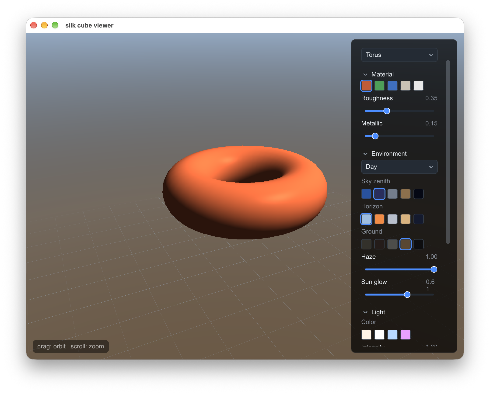

---
hide:
  - navigation
  - toc
---

# slikui

A sleek, header-only **C++20** UI library for graphics applications —
retained-mode widget tree, declarative builder API, one narrow rendering
contract that runs on **raw pixels or any graphics API**. No build step, no
dependencies. [Python bindings](getting-started/python.md) are first-class
citizens with the same widget surface.

```sh
# C++  — drop in the header, done
#include "slikui.hpp"

# Python
pip install slikui-python
```



## What you get

- **Header-only** — `slikui.hpp` (multi-header) or `dist/slikui.hpp`
  (amalgamated single file). No linking, no code generation.
- **Backends** — a CPU rasterizer over raw `uint32_t` pixels (headless,
  embedded, blit into any engine) and a GL 3.3 core renderer on system
  headers. Anything else (Vulkan, Metal, SDL_Renderer) implements one
  interface: [Render backends](guide/backends.md).
- **Widget set** — 50+ widgets: controls, inputs, editors, plots, trees,
  tables, property grids, menus, toolbars with procedural icons, dialogs,
  toasts, image views. [Widget index](reference/index.md).
- **Theming** — palette-driven styling, 8 built-in presets, HiDPI scale.
  [Theming](guide/theming.md).
- **Text** — vendored stb_truetype: glyph atlas, kerning, word wrapping,
  optional bundled DejaVu subset. [Text & fonts](guide/text-fonts.md).
- **Testable** — one event vocabulary, real captured screenshots
  (`tools/components_capture.cpp`), golden-image pixel checks in CI.

## Start here

- [Getting started — C++](getting-started/cpp.md)
- [Getting started — Python](getting-started/python.md)
- [Core concepts](guide/core-concepts.md) — the frame loop
- [Widget index](reference/index.md)

Site contents are also available machine-readable at
[llms.txt](https://jamesgregson.github.io/slikui/llms.txt) and
[llms-full.txt](https://jamesgregson.github.io/slikui/llms-full.txt) — the
whole site as plain markdown for agents and offline consumption.
