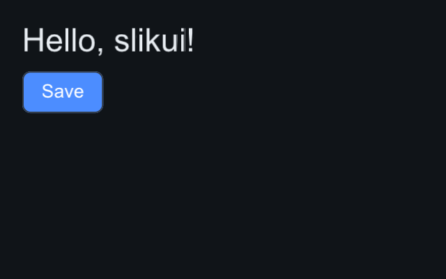

# Python bindings

The `slikui` PyPI package binds the C++ API 1:1 through nanobind
(`slikui._slikui`), then adds a thin Pythonic surface in `slikui._py`:
kwargs-to-setters, the `App` shell, event constructors and pixel helpers.
New widgets land C++-first so both languages get them.

## App shell

`App` holds Target + Sink + Context and every owner, so the C++ side never
sees a dangling backend:

```python
import slikui

ui = slikui.App(320, 200, scale=1.0)      # + font=..., theme=...
root = ui.set_root(slikui.Column, padding=16, gap=8)
root.add(slikui.Label, "Hello, slikui!", font_size=26)
root.add(slikui.Button, "Save", variant=slikui.ButtonVariant.Primary)

ui.tick(0.0, 1 / 60)                       # layout + animation
frame = ui.render()                        # zero-copy (H, W) uint32 ndarray
```



- `App(width, height, *, font=None, scale=1.0, theme=None)` — the logical
  frame is `width x height`; the framebuffer carries the scale. Font defaults
  to the system font, falling back to the bundled DejaVu subset when none
  exists (headless containers).
- `resize(w, h)` — re-targets both.
- `close()` — destroys the tree and releases the Python callbacks it holds;
  run automatically by `with App(...) as ui:` and at exit. Safe to call
  twice. GUI apps that keep their UI until interpreter shutdown can silence
  the leak report with `slikui.set_leak_warnings(False)`.
- `render()` returns the framebuffer as a zero-copy `numpy` array, 0xAABBGGRR
  packing; `slikui.to_rgba(frame)` and `slikui.save_image(frame, path)`
  convert/save.

## Builder sugar

`container.add(cls, *args, **props)` constructs the widget and applies
kwargs: `foo=` resolves to `set_foo`, or to the attribute/method `foo`
itself when there is no setter (e.g. `on_click=`). A wrong name is a loud
`AttributeError`, not a silent no-op. Same for `ctx.set_root(cls, ...)`.
If type-level patching is unavailable, module-level
`slikui.add(container, ...)` / `slikui.set_root(context, ...)` are the
fallbacks.

## Events

Real `Event` values drive the real dispatch path — simulated-input tests use
them:

```python
ui.handle(slikui.mouse_press((60, 40)))   # click through hit-testing
ui.handle(slikui.text_input("h"))         # into the focused TextField
ui.handle(slikui.scroll(pos, (0, -1)))    # wheel, "ctrl+shift" mods supported
ui.handle(slikui.key_press(slikui.Key.S, slikui.mods("ctrl")))
ui.handle(slikui.frame_resize(960, 640))  # framebuffer pixels
```

Constructors: `mouse_move`, `mouse_press`, `mouse_release`, `mouse_click`,
`scroll`, `key_press`, `key_release`, `text_input`, `text_input_str`,
`focus_lost`, `frame_resize`; `mods("ctrl+shift")` builds the modifier mask.

## Your own renderer

`slikui.RenderSink` is a trampoline over C++ `IRenderSink`: subclass it,
implement `upload(tex)` and `render(commands, fb_size)`, and slikui hands you
every frame as a flat command list — point it at pygame, moderngl, PIL,
anything.

`slikui.CanvasSink` is a worked example: a pure-numpy rasterizer producing
**pixel-identical** output to the C++ software backend (same blend/SDF/
sampling math, verified by test):

```python
sink = slikui.CanvasSink(320, 240)
ctx = slikui.Context(sink)          # any RenderSink subclass works here
ctx.set_frame_size(320, 240)
ctx.load_default_font()             # or load_font_file(path)
# ... build the tree, tick ...
ctx.render()
frame = sink.buffer                 # (240, 320) uint32, 0xAABBGGRR
```

See it side by side: `python python/examples/pyrenderer_demo.py` renders one
tree through both renderers and reports the pixel diff (it is 0).


## Custom widgets in Python

Subclass `slikui.Widget` and implement `measure` / `paint` / `on_event`
(plus opt-in `tick`, `stretch_cross`, `expands_main`, `focusable`,
`widget_type`) — the C++ core lays out, paints, hit-tests and dispatches
events to your class. Full details:
[Custom widgets](../guide/custom-widgets.md).

Rules: `super().__init__()` is required; subclassing the *bound* C++ widget
types (`Column`, `Row`, ...) is rejected — build layouts from Python code
instead. Add instances with `container.add_widget(obj)` or
`container.add(Meter, ...)`; a custom root is
`context.set_root_widget(...)`.

## Versions, wheels, sources

- PyPI: `pip install slikui-python` — wheels for Python 3.10–3.14 on Linux
  x86_64/aarch64, macOS arm64, Windows x64; no wheel → pip builds from the
  sdist (needs a C++20 compiler).
- The same files are attached to every GitHub Release; the C++ side is
  header-only, nothing to link.
- Source layout: `python/slikui/_slikui` (compiled bindings),
  `slikui/_py` (App, builder, events, pixels, CanvasSink),
  `python/tests`, `python/examples`.
