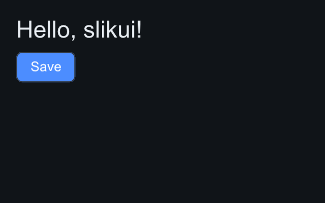

# Python bindings

The `slikui` PyPI package binds the C++ API 1:1 through nanobind
(`slikui._slikui`), then adds a thin Pythonic surface in `slikui._py`:
kwargs-to-setters, the `App` shell, event constructors and pixel helpers.
New widgets land C++-first so both languages get them.

## App shell

`App` holds Target + Sink + Context and every owner, so the C++ side never
sees a dangling backend:

```python
import slikui

ui = slikui.App(320, 200, scale=1.0)      # + font=..., theme=...
root = ui.set_root(slikui.Column, padding=16, gap=8)
root.add(slikui.Label, "Hello, slikui!", font_size=26)
root.add(slikui.Button, "Save", variant=slikui.ButtonVariant.Primary)

ui.tick(0.0, 1 / 60)                       # layout + animation
frame = ui.render()                        # zero-copy (H, W) uint32 ndarray
```



- `App(width, height, *, font=None, scale=1.0, theme=None)` - the logical
  frame is `width x height`; the framebuffer carries the scale. Font defaults
  to the system font, falling back to the bundled DejaVu subset when none
  exists (headless containers).
- `resize(w, h)` - re-targets both.
- `close()` - destroys the tree and releases the Python callbacks it holds;
  run automatically by `with App(...) as ui:` and at exit. Safe to call
  twice. GUI apps that keep their UI until interpreter shutdown can silence
  the leak report with `slikui.set_leak_warnings(False)`.
- `render()` returns the framebuffer as a zero-copy `numpy` array, 0xAABBGGRR
  packing; `slikui.to_rgba(frame)` and `slikui.save_image(frame, path)`
  convert/save.

## Builder sugar

`container.add(cls, *args, **props)` constructs the widget and applies
kwargs: `foo=` resolves to `set_foo`, or to the attribute/method `foo`
itself when there is no setter (e.g. `on_click=`). A wrong name is a loud
`AttributeError`, not a silent no-op. Same for `ctx.set_root(cls, ...)`.
For your own widget classes, kwargs named in `__init__` go to the
constructor and the rest to setters: `row.add(Knob, value=3, tooltip="t")`
calls `Knob(value=3)`, then `set_tooltip("t")`.

Values: `Color(r, g, b, a=255)` takes 0..255 ints; use
`Color.from_float(r, g, b, a=1.0)` for normalized floats.
`Constraints(min, max)` builds arbitrary constraints (also `loose`, `tight`).
If type-level patching is unavailable, module-level
`slikui.add(container, ...)` / `slikui.set_root(context, ...)` are the
fallbacks.

## Events

Real `Event` values drive the real dispatch path - simulated-input tests use
them:

```python
ui.handle(slikui.mouse_press((60, 40)))   # click through hit-testing
ui.handle(slikui.text_input("h"))         # into the focused TextField
ui.handle(slikui.scroll(pos, (0, -1)))    # wheel, "ctrl+shift" mods supported
ui.handle(slikui.key_press(slikui.Key.S, slikui.mods("ctrl")))
ui.handle(slikui.frame_resize(960, 640))  # framebuffer pixels
```

Constructors: `mouse_move`, `mouse_press`, `mouse_release`, `mouse_click`,
`scroll`, `key_press`, `key_release`, `text_input`, `text_input_str`,
`focus_lost`, `frame_resize`; `mods("ctrl+shift")` builds the modifier mask.

## Your own renderer

`slikui.RenderSink` is a trampoline over C++ `IRenderSink`: subclass it,
implement `upload(tex)` and `render(commands, fb_size)`, and slikui hands you
every frame as a flat command list - point it at pygame, moderngl, PIL,
anything.

```python
class MySink(slikui.RenderSink):
    def upload(self, up):
        # up.pixels: zero-copy read-only view, (H, W) uint8 for Alpha8,
        # (H, W, 4) for Rgba8. Valid during this call only: copy or upload.
        self.textures[up.id] = make_texture(up.id, up.pixels)

    def release(self, tex_id):          # optional: the owning widget died
        self.textures.pop(tex_id).free()

    def render(self, cmds, fb_size):
        a = cmds.as_array()             # (N,) slikui.DRAWCMD_DTYPE, zero-copy
        rects = a[a["type"] == slikui.DrawCmdType.Rect.value]
        ...                             # a["rect"] (N, 4) f32, a["color"] (N, 4) u8
```

- **`cmds.as_array()`** is the fast path: one read-only structured view over
  the C++ command storage (fields `type rect radius thickness hollow color
  tex_id uv`, see `slikui.DRAWCMD_DTYPE`), about 18x cheaper than
  `for c in cmds` on the gallery. Like `up.pixels` it borrows C++ memory
  valid only during the call - `.copy()` to keep it.
- **`release(tex_id)`** is called when an `Image`, `ImageView` or
  `CompareView` is destroyed. It can run outside `render()` (e.g. from
  `ctx.clear_tree()`), so a GPU sink should queue the delete until a context
  is current. Exceptions raised there are reported as unraisable, not
  propagated. The default is a no-op.
- **`ctx.invalidate_textures()`**: call after your sink lost its textures
  (GL context recreated); the next `render()` re-uploads the font atlas and
  every live widget texture.

`slikui.CanvasSink` is a worked example: a pure-numpy rasterizer producing
**pixel-identical** output to the C++ software backend (same blend/SDF/
sampling math, verified by test):

```python
sink = slikui.CanvasSink(320, 240)
ctx = slikui.Context(sink)          # any RenderSink subclass works here
ctx.set_frame_size(320, 240)
ctx.load_default_font()             # or load_font_file(path)
# ... build the tree, tick ...
ctx.render()
frame = sink.buffer                 # (240, 320) uint32, 0xAABBGGRR
```

See it side by side: `python python/examples/pyrenderer_demo.py` renders one
tree through both renderers and reports the pixel diff (it is 0).


## OpenGL: `GlApp` and `GLSink`

For a PyOpenGL host (glfw, pygame, Qt, ...) the UI can draw straight into
your GL 3.3 context - no CPU framebuffer, no per-frame texture upload:

```python
app = slikui.GlApp(960, 640, scale=fb_w / win_w)   # GL context current
root = app.set_root(slikui.Column, padding=12)
...
while running:
    app.set_scale(fb_w / win_w); app.resize(win_w, win_h)   # before tick
    app.tick(now, dt)
    draw_scene()
    app.render(clear=False)        # over the scene; clear=True paints the background
    swap_buffers()
app.close()                        # BEFORE destroying the window (frees GL objects)
```

`GlApp` wraps `slikui.GLSink`, a `RenderSink` built on the C++
`slikui.GpuBatcher`: each frame is one buffer upload plus one instanced draw
per scissor/texture batch (a handful per frame). On the gallery it renders
in ~0.5 ms/frame at 1x and ~0.6 ms at 2x, against ~3 ms / ~11 ms for the C++
software sink, before that path's texture upload
(`python/benchmarks/bench_render.py`).

- **GL state**: `render()` sets viewport, program, VAO, texture unit 0,
  blending and scissor, disables depth/cull/stencil, and leaves them -
  set what your next pass needs. `GLSink(preserve_state=True)` saves and
  restores them instead (slower: `glGet*` per frame).
- **Lifecycle**: `init()` / `shutdown()` need the context current;
  `release()` only queues texture deletes. After a lost/recreated context,
  `app.reset()` (or `sink.reset(ctx)`) rebuilds GL objects and re-uploads.
  One sink per `Context`, one GL context per sink.
- `slikui.read_framebuffer(w, h)` reads the bound framebuffer in
  `Target.pixels()` layout (tests, screenshots).
- `--window` examples use `GlApp`; add `--software` for the CPU path.

**Input from your GLFW window** (`slikui.glfw_input`, pyGLFW; `import
slikui` never imports glfw):

```python
inp = slikui.GlfwInput(win, app)   # chains to callbacks you set earlier
slikui.glfw_input.attach_services(app.ctx, win)   # clipboard + cursors
...
glfw.poll_events()                 # events reach app.handle() as they arrive
...
inp.close()                        # restore your callbacks (window alive)
```

`GlfwInput(win)` without a target queues events (`inp.take()`) for hosts
that route them (UI vs scene). Or skip it and call the builders from your
own callbacks: `slikui.glfw_input.mouse_button_event(win, button, action,
mods)`, `cursor_pos_event`, `scroll_event`, `key_event`, `char_event`,
`focus_event`, `framebuffer_size_event` - `python/examples/glfw_demo.py`
does this. Always map buttons through them (or `map_button`): GLFW's
RIGHT=1/MIDDLE=2 are slikui's MouseMiddle=1/MouseRight=2 swapped.

**Input from your SDL3 window** (`slikui.sdl_input`, PySDL3; `import slikui`
never imports sdl3): `inp = slikui.SdlInput(window, app)`, then
`inp.process(ev)` for each polled event (returns False for events slikui
doesn't use). `translate(ev)` is the stateless builder;
`attach_services(ctx)` wires clipboard and cursors. Full host:
`python/examples/sdl_demo.py`.

**Routing between UI and scene**: `app.ctx.wants_mouse(x, y)` and
`app.ctx.wants_keyboard()` say whether an event belongs to the UI (layout
widgets - Column, Row, Spacer - let the pointer through; a custom widget
can return True from `mouse_transparent()` to do the same).

**moderngl hosts**: `slikui.ModernGLSink(mgl_ctx, scale=...)` is the same
sink over a `moderngl.Context` (`pip install moderngl`) - lower per-call
overhead than PyOpenGL (~0.36 ms/frame on the gallery vs ~0.6 ms). It draws
into `mgl_ctx.fbo` and leaves `enable_only(BLEND)` in effect; wrap the call
in `mgl_ctx.scope(...)` to keep your own state.

```python
sink = slikui.ModernGLSink(mgl, scale=fb_w / win_w).init()
ctx = slikui.Context(sink)
...
ctx.render(False)          # over your scene, into mgl.fbo
...
ctx.clear_tree(); sink.shutdown()
```

`slikui.GpuBatcher().build(list, frame, scale)` returns the arrays
zero-copy - `(N, 20)` float32 instances and `(M, 7)` int32 batches - with
`slikui.GPU_VERTEX_SHADER` / `GPU_FRAGMENT_SHADER`, for other APIs (wgpu,
Vulkan via Python, ...). See [Render backends](../guide/backends.md).

## Custom widgets in Python

Subclass `slikui.Widget` and implement `measure` / `paint` / `on_event`
(plus opt-in `tick`, `stretch_cross`, `expands_main`, `focusable`,
`widget_type`) - the C++ core lays out, paints, hit-tests and dispatches
events to your class. Full details:
[Custom widgets](../guide/custom-widgets.md).

Rules: `super().__init__()` is required. `Panel`, `Column` and `Row` can be
subclassed the same way (overrides dispatch, and `super().paint(env)` /
`super().measure(c)` reach the built-in behaviour) - e.g. a `Panel` subclass
as a popup root that sees `PopupClosed`. Other bound widget types (`Button`,
`Slider`, ...) have no override seam: defining `on_event`, `paint`, ... on
such a subclass raises `TypeError` when the class is created. Add instances
with `container.add_widget(obj)` or `container.add(Meter, ...)`; a custom
root is `context.set_root_widget(...)`.

Wrappers of built-in widgets are views of widgets the C++ tree owns. Once
the tree destroys one (`remove`, `clear_children`, `App.close()`), using an
old wrapper raises `TypeError` (with a "nanobind: attempted to access an
uninitialized instance" `RuntimeWarning`) instead of touching freed memory.

## Versions, wheels, sources

- PyPI: `pip install slikui-python` - wheels for Python 3.10-3.14 on Linux
  x86_64/aarch64, macOS arm64, Windows x64; no wheel -> pip builds from the
  sdist (needs a C++20 compiler).
- The same files are attached to every GitHub Release; the C++ side is
  header-only, nothing to link.
- Source layout: `python/slikui/_slikui` (compiled bindings),
  `slikui/_py` (App, builder, events, pixels, CanvasSink),
  `slikui/examples` (shipped demos), `python/tests`,
  `python/examples` (repo-only interactive twins).
