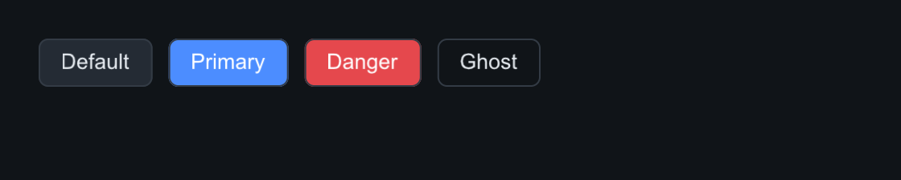
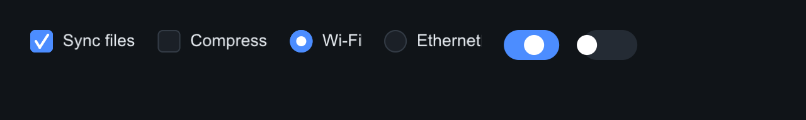
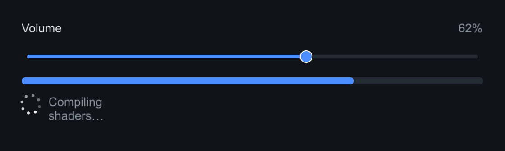
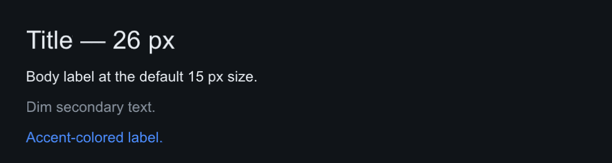

# Controls

Buttons, toggles, sliders, progress and labels. All follow the same pattern:
fluent setters returning `Widget&`, theme-driven colors, animated hover/press
transitions, keyboard focus support.

Common to every widget (from the
[`Widget`](#widget-base-class) base): `set_tooltip`, `set_context_menu`,
`set_cursor`, the state flags `visible`, `enabled`, `focused`, and the
optional `id` used by `ctx.find(id)`.

Each image below is real output: `tools/components_capture.cpp` builds the
tree from the snippet with the software backend, simulates a second of
interaction, and dumps the framebuffer.

## Button

Four variants: `Default`, `Primary` (accent fill), `Danger`, `Ghost`
(borderless, quiet action). `on_click` fires on release inside the widget;
hover/press transitions are animated by the theme.

=== "C++"

    ```cpp
    auto& row = root.add<slikui::Row>();
    row.set_gap(10);
    row.add<slikui::Button>("Default");
    row.add<slikui::Button>("Primary").set_variant(slikui::Button::Variant::Primary);
    row.add<slikui::Button>("Danger").set_variant(slikui::Button::Variant::Danger);
    row.add<slikui::Button>("Ghost").set_variant(slikui::Button::Variant::Ghost);
    ```

=== "Python"

    ```python
    row = root.add(slikui.Row, gap=10)
    row.add(slikui.Button, "Default")
    row.add(slikui.Button, "Primary", variant=slikui.ButtonVariant.Primary)
    row.add(slikui.Button, "Danger", variant=slikui.ButtonVariant.Danger)
    row.add(slikui.Button, "Ghost", variant=slikui.ButtonVariant.Ghost)
    ```



| API | Signature |
|-----|-----------|
| `set_text` | `(std::string)` |
| `set_variant` | `(Button::Variant)` |
| `set_padding` | `(float h, float v)` |
| `on_click` | `(std::function<void()>)` |

## Checkbox, Radio, Switch

All three are bool controls with `set_checked(bool, bool fire_callback = false)`
and `on_change(void(bool))`. `Radio` gives you the visuals; exclusivity within
a group is yours to wire (set the others false in the callback).

=== "C++"

    ```cpp
    auto& row = root.add<slikui::Row>();
    row.set_gap(18);
    row.add<slikui::Checkbox>("Sync files", true);
    row.add<slikui::Checkbox>("Compress", false);
    row.add<slikui::Radio>("Wi-Fi", true);
    row.add<slikui::Radio>("Ethernet", false);
    row.add<slikui::Switch>().set_checked(true);
    row.add<slikui::Switch>().set_checked(false);
    ```

=== "Python"

    ```python
    row = root.add(slikui.Row, gap=18)
    row.add(slikui.Checkbox, "Sync files", True)
    row.add(slikui.Checkbox, "Compress", False)
    row.add(slikui.Radio, "Wi-Fi", True)
    row.add(slikui.Radio, "Ethernet", False)
    row.add(slikui.Switch, checked=True)
    row.add(slikui.Switch, checked=False)
    ```



| API | Signature |
|-----|-----------|
| `set_checked` | `(bool checked, bool fire_callback = false)` |
| `on_change` | `(std::function<void(bool)>)` |

## Slider, ProgressBar, Spinner

`Slider` drives a float range (`set_range`, `set_value`, `on_change`) and can
carry its own caption row — `set_label` adds a title with a live formatted
value on the right (`set_format`, e.g. `"%.2f"`), `set_log_scale` makes
picking across magnitudes sane, and `set_step` quantizes clicks and wheel
ticks. `ProgressBar` shows a clamped 0–1 fraction; `Spinner` animates forever
and takes `set_speed` (degrees per second) — it is driven by the time you
pass to `ctx.tick`, so it pauses with your app.

=== "C++"

    ```cpp
    auto& cap = root.add<slikui::Row>();
    cap.set_gap(8);
    cap.add<slikui::Label>("Volume");
    cap.add<slikui::Spacer>();
    cap.add<slikui::Label>("62%").set_color(ctx.theme().text_dim);
    root.add<slikui::Slider>(0.f, 100.f).set_value(62.f);
    root.add<slikui::ProgressBar>().set_value(0.72f);
    auto& busy = root.add<slikui::Row>();
    busy.set_gap(10);
    busy.add<slikui::Spinner>();
    busy.add<slikui::Label>("Compiling shaders…").set_color(ctx.theme().text_dim);
    ```

=== "Python"

    ```python
    cap = root.add(slikui.Row, gap=8)
    cap.add(slikui.Label, "Volume")
    cap.add(slikui.Spacer)
    cap.add(slikui.Label, "62%").set_color(ui.ctx.theme.text_dim)
    root.add(slikui.Slider, 0, 100, value=62)
    root.add(slikui.ProgressBar, value=0.72)
    busy = root.add(slikui.Row, gap=10)
    busy.add(slikui.Spinner)
    busy.add(slikui.Label, "Compiling shaders…").set_color(ui.ctx.theme.text_dim)
    ```



| API | Signature |
|-----|-----------|
| `Slider::set_range` | `(float min, float max)` |
| `Slider::set_value` | `(float, bool fire_callback = false)` |
| `Slider::set_label` | `(std::string)` — built-in caption row, live value on the right |
| `Slider::set_format` | `(const char* printf_format)` |
| `Slider::set_log_scale` | `(bool)` |
| `Slider::set_step` | `(float)` |
| `Slider::on_change` | `(std::function<void(float)>)` |
| `ProgressBar::set_value` | `(float 0–1)` |
| `Spinner::set_speed` | `(float degrees/sec)` |

The built-in caption row is demonstrated in the
[Editors](widgets-editors.md) example (`Roughness %.2f`).

## Label

Static text. `set_font_size` overrides the theme's base size, `set_color`
overrides the theme text color, `set_wrap_width` word-wraps.

=== "C++"

    ```cpp
    root.add<slikui::Label>("Title — 26 px").set_font_size(26);
    root.add<slikui::Label>("Body label at the default 15 px size.");
    root.add<slikui::Label>("Dim secondary text.").set_color(ctx.theme().text_dim);
    root.add<slikui::Label>("Accent-colored label.").set_color(ctx.theme().accent);
    ```

=== "Python"

    ```python
    root.add(slikui.Label, "Title — 26 px", font_size=26)
    root.add(slikui.Label, "Body label at the default 15 px size.")
    root.add(slikui.Label, "Dim secondary text.").set_color(ui.ctx.theme.text_dim)
    root.add(slikui.Label, "Accent-colored label.").set_color(ui.ctx.theme.accent)
    ```



| API | Signature |
|-----|-----------|
| `set_text` | `(std::string)` |
| `set_font_size` | `(float px)` |
| `set_color` | `(Color)` |
| `set_wrap_width` | `(float px)` |

## Widget base class

Every widget inherits from `slikui::Widget`:

| Member | Kind |
|--------|------|
| `add<T>(args...)` | construct + own a child, returns `T&` |
| `find(id)` | search subtree by `id` |
| `set_tooltip` / `set_context_menu` / `set_cursor` | hover text / right-click menu / cursor shape |
| `visible`, `enabled`, `focused`, `id`, `bounds` | public state |
| `parent`, `children` | tree links |
| `focusable()`, `expands_main()`, `stretch_cross()` | layout/focus opt-ins (virtual) |

!!! note "Setter chaining"

    Setters return `Widget&` (no deducing-this before C++23), so base-class
    setters like `set_tooltip` must come **last** in a fluent chain.
