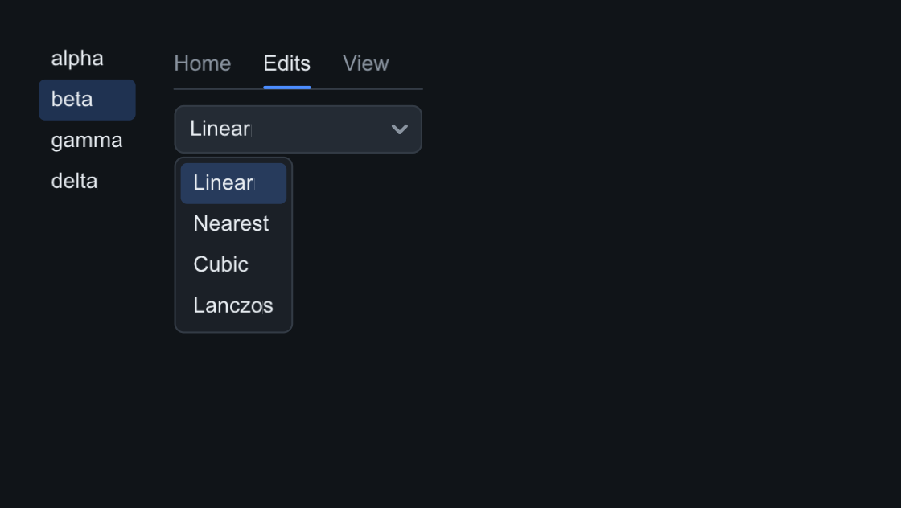
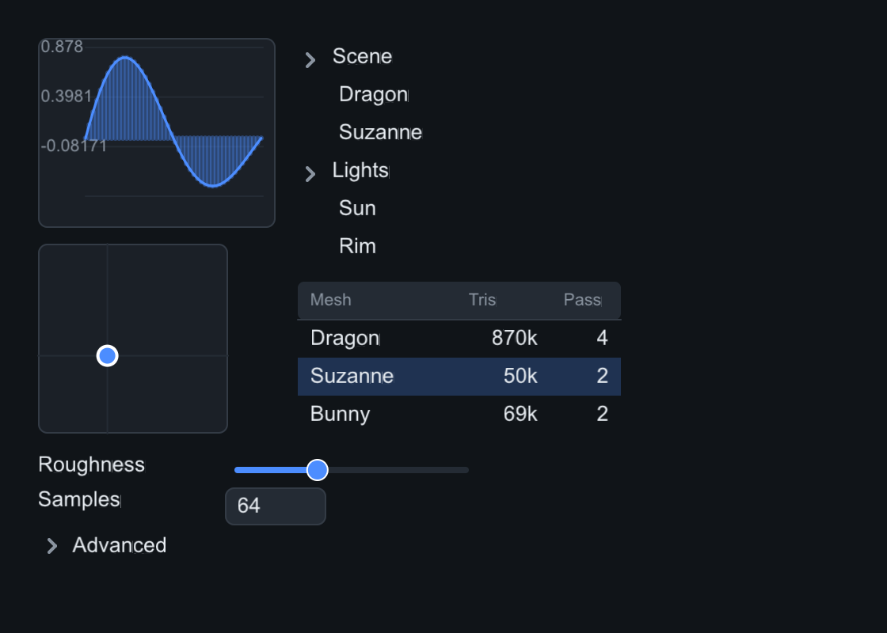
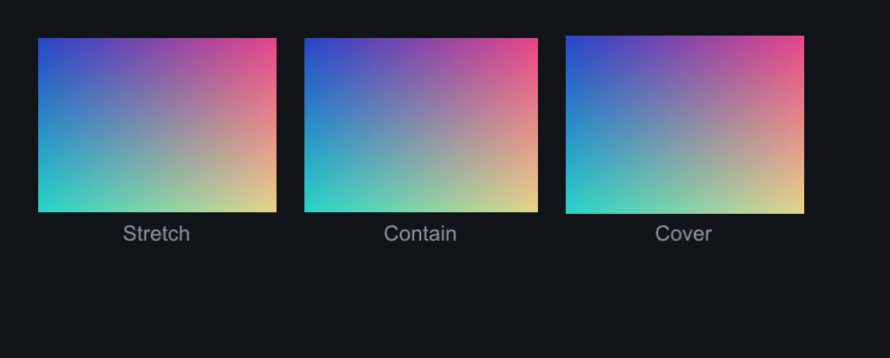

# Data display

The data-display family for demo panels: lists, trees, tables, the property
inspector, plots and images. Series and rows accept `numpy` arrays in Python
and `std::vector` in C++.

Each image is real output from `tools/components_capture.cpp` — the snippets
are the capture code.

## ListView, Tabs, Dropdown

`ListView` is a selectable item list (`on_select(void(size_t))`). `Tabs` is a
tab bar (`set_tabs`, `on_change`). `Dropdown` opens its selection popup on
click — the screenshot shows it after a simulated press:

=== "C++"

    ```cpp
    auto& row = root.add<slikui::Row>();
    row.set_gap(24);
    auto& list = row.add<slikui::ListView>();
    list.set_items({"alpha", "beta", "gamma", "delta"}).set_selected(1);
    auto& col = row.add<slikui::Column>();
    col.set_gap(10);
    col.add<slikui::Tabs>().set_tabs({"Home", "Edits", "View"}).set_selected(1);
    col.add<slikui::Dropdown>().set_items({"Linear", "Nearest", "Cubic", "Lanczos"})
        .set_placeholder("Filter…").set_selected(0);
    ```

=== "Python"

    ```python
    row = root.add(slikui.Row, gap=24)
    row.add(slikui.ListView, items=["alpha", "beta", "gamma", "delta"],
            selected=1)
    col = row.add(slikui.Column, gap=10)
    col.add(slikui.Tabs, tabs=["Home", "Edits", "View"], selected=1)
    col.add(slikui.Dropdown, items=["Linear", "Nearest", "Cubic", "Lanczos"],
            placeholder="Filter…", selected=0)
    ```



| API | Signature |
|-----|-----------|
| `ListView::set_items` | `(std::vector<std::string>)` |
| `ListView::set_selected` | `(long index)` |
| `ListView::on_select` | `(std::function<void(size_t)>)` |
| `Tabs::set_tabs` | `(std::vector<std::string>)` |
| `Tabs::set_selected` / `on_change` | tab index |
| `Dropdown::set_items` / `set_placeholder` / `set_selected` / `on_select` | like ListView |

## Plot

Line series with autoscale (or `set_x_range`/`set_y_range`), grid + tick
labels, optional area fill, markers — and `set_bars` turns series 0 into a
histogram.

=== "C++"

    ```cpp
    auto& plot = left.add<slikui::Plot>().set_fill(true);
    std::vector<slikui::Vec2> pts;
    for (int i = 0; i < 48; ++i) {
        float x = float(i) / 47.f * 6.2831f;
        pts.push_back({x, std::sin(x) * std::exp(-x / 6.f)});
    }
    plot.add_series(pts, ctx.theme().accent);
    ```

=== "Python"

    ```python
    import numpy as np
    xs = np.linspace(0, 6.2831, 48)
    ys = (np.sin(xs) * np.exp(-xs / 6)).astype(np.float32)
    plot = left.add(slikui.Plot, fill=True)
    plot.set_series(ys, ui.ctx.theme.accent)
    ```

| API | Signature |
|-----|-----------|
| `set_series` | C++ `(std::vector<Vec2>, color)` · Python `(ys_array, color)` |
| `add_series` | extra series (C++ also `(xs_array, ys_array, color)` in Python) |
| `set_x_range` / `set_y_range` | `(min, max)` — disable autoscale |
| `set_bars` / `set_fill` / `set_markers` | `(bool)` |

## Vec2Pad

A 2D pad with a draggable dot — light directions, UV offsets. Pictured bottom
left of the capture below.

=== "C++"

    ```cpp
    left.add<slikui::Vec2Pad>().set_value({0.35f, 0.4f});
    ```

=== "Python"

    ```python
    left.add(slikui.Vec2Pad).set_value(slikui.Vec2(0.35, 0.4))
    ```

| API | Signature |
|-----|-----------|
| `set_value` | `(Vec2, bool fire_callback = false)` |
| `set_range` | `(Vec2 min, Vec2 max)` |
| `on_change` | `(std::function<void(Vec2)>)` |

## TreeView

Takes a flat `(label, depth, expandable)` row list; expansion state lives in
the widget, chevron clicks toggle, rows select.

=== "C++"

    ```cpp
    right.add<slikui::TreeView>().set_rows({
        {"Scene", 0, true}, {"Dragon", 1}, {"Suzanne", 1},
        {"Lights", 0, true}, {"Sun", 1}, {"Rim", 1},
    });
    ```

=== "Python"

    ```python
    right.add(slikui.TreeView, rows=[
        slikui.TreeView.Row("Scene", 0, True),
        slikui.TreeView.Row("Dragon", 1),
        slikui.TreeView.Row("Suzanne", 1),
        slikui.TreeView.Row("Lights", 0, True),
        slikui.TreeView.Row("Sun", 1),
        slikui.TreeView.Row("Rim", 1),
    ])
    ```

## Table

Columns + header + selectable rows with per-column alignment and cell
clipping. `set_columns` takes `(title, width, right_align?)` specs.

=== "C++"

    ```cpp
    auto& table = right.add<slikui::Table>();
    table.set_columns({{"Mesh", 100, false}, {"Tris", 60, true},
                       {"Pass", 44, true}});
    table.set_rows({{"Dragon", "870k", "4"}, {"Suzanne", "50k", "2"},
                    {"Bunny", "69k", "2"}});
    table.set_selected(1);
    ```

=== "Python"

    ```python
    table = right.add(slikui.Table)
    table.set_columns([
        slikui.Table.ColumnSpec("Mesh", 100),
        slikui.Table.ColumnSpec("Tris", 60, right_align=True),
        slikui.Table.ColumnSpec("Pass", 44, right_align=True),
    ])
    table.set_rows([["Dragon", "870k", "4"], ["Suzanne", "50k", "2"],
                    ["Bunny", "69k", "2"]])
    table.set_selected(1)
    ```

## PropertyGrid

The inspector: `add_property(label)` rows with a fixed label column (drop any
editor into the returned row) and collapsible `add_section`s.

=== "C++"

    ```cpp
    auto& grid = root.add<slikui::PropertyGrid>();
    grid.add_property("Roughness").add<slikui::Slider>(0.f, 1.f).set_value(0.35f, false);
    grid.add_property("Samples").add<slikui::DragValue>(64.f);
    grid.add_section("Advanced");
    ```

=== "Python"

    ```python
    grid = root.add(slikui.PropertyGrid)
    grid.add_property("Roughness").add(slikui.Slider, 0, 1, value=0.35)
    grid.add_property("Samples").add(slikui.DragValue, 64)
    grid.add_section("Advanced")
    ```



## Image

Decodes PNG/JPEG via vendored stb_image. Feed it pixels you already have
(`set_pixels`), a file (`set_file`), or an encoded memory blob (`set_memory`).
`set_fit` chooses how the source maps into the widget rect. Textures upload
through the same `TexUpload` channel as the font atlas, so every backend gets
it for free.

=== "C++"

    ```cpp
    auto& row = root.add<slikui::Row>();
    row.set_gap(16);
    const char* names[3] = {"Stretch", "Contain", "Cover"};
    slikui::Image::Fit fits[3] = {slikui::Image::Fit::Stretch,
                                  slikui::Image::Fit::Contain,
                                  slikui::Image::Fit::Cover};
    for (int i = 0; i < 3; ++i) {
        auto& cell = row.add<slikui::Column>();
        cell.set_gap(6).set_cross(slikui::CrossMode::Center);
        cell.add<slikui::Image>("gradient").set_pixels(64, 48, grad_rgba)
            .set_size(150, 110).set_fit(fits[i]);
        cell.add<slikui::Label>(names[i]).set_color(ctx.theme().text_dim);
    }
    ```

=== "Python"

    ```python
    row = root.add(slikui.Row, gap=16)
    for name, fit in [("Stretch", slikui.ImageFit.Stretch),
                      ("Contain", slikui.ImageFit.Contain),
                      ("Cover", slikui.ImageFit.Cover)]:
        cell = row.add(slikui.Column, gap=6, cross=slikui.CrossMode.Center)
        cell.add(slikui.Image, "gradient").set_pixels(64, 48, grad_rgba) \
            .set_size(150, 110).set_fit(fit)
        cell.add(slikui.Label, name).set_color(ui.ctx.theme.text_dim)
    ```


