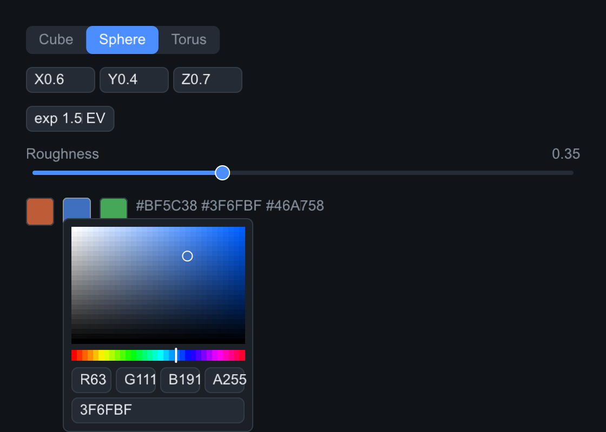

# Editors

Widgets for tuning numbers and colors in demo panels — all C++ core, so the
Python bindings get the same surface (see `python/tests/test_editors.py`).

`DragValue` scrubs a value like a Blender number field: drag horizontally to
change it, click to type, Enter commits, Escape cancels, arrows nudge when
focused. `Vec2Edit`/`Vec3Edit`/`Vec4Edit` give one labeled field per axis and
**borrow** the caller's `float[N]` — edits write into it and external writes
mirror back on the next tick (numpy arrays work as-is). `ColorEdit` is a
swatch that opens an SV square + hue popup with hex and RGBA fields.
`Segmented` is a compact radio-style row.

## The family, as pictured

Every image on this site is real output: `tools/components_capture.cpp`
builds this exact tree with the software backend, hovers and clicks the
middle color chip so the picker popup is open, and dumps the framebuffer.

=== "C++"

    ```cpp
    root.add<slikui::Segmented>().set_items({"Cube", "Sphere", "Torus"})
        .set_selected(1);
    static float light_dir[3] = {0.60f, 0.40f, 0.70f};
    root.add<slikui::Vec3Edit>(light_dir, "XYZ");   // borrows the array
    root.add<slikui::DragValue>(1.5f).set_prefix("exp ").set_suffix(" EV");
    root.add<slikui::Slider>(0.f, 1.f).set_label("Roughness")  // built-in caption row
        .set_format("%.2f").set_value(0.35f);
    auto& colors = root.add<slikui::Row>();
    colors.set_gap(8);
    colors.add<slikui::ColorEdit>(slikui::Color::from_hex(0xBF5C38));
    colors.add<slikui::ColorEdit>(slikui::Color::from_hex(0x3F6FBF));
    colors.add<slikui::ColorEdit>(slikui::Color::from_hex(0x46A758));
    colors.add<slikui::Label>("#BF5C38 #3F6FBF #46A758")
        .set_color(ctx.theme().text_dim);
    ```

=== "Python"

    ```python
    import numpy as np

    root.add(slikui.Segmented, items=["Cube", "Sphere", "Torus"], selected=1)
    light_dir = np.array([0.60, 0.40, 0.70], dtype=np.float32)
    root.add(slikui.Vec3Edit, light_dir, "XYZ")     # borrows the array
    root.add(slikui.DragValue, 1.5, prefix="exp ", suffix=" EV")
    root.add(slikui.Slider, 0, 1, label="Roughness", format="%.2f", value=0.35)
    colors = root.add(slikui.Row, gap=8)
    colors.add(slikui.ColorEdit, color=slikui.Color.from_hex(0xBF5C38))
    colors.add(slikui.ColorEdit, color=slikui.Color.from_hex(0x3F6FBF))
    colors.add(slikui.ColorEdit, color=slikui.Color.from_hex(0x46A758))
    colors.add(slikui.Label, "#BF5C38 #3F6FBF #46A758") \
        .set_color(ui.ctx.theme.text_dim)
    ```



!!! note

    The labeled `Slider` in this tree demonstrates `Slider`'s built-in
    caption row; the full `Slider` API lives on
    [Controls](widgets-controls.md#slider-progressbar-spinner).

## Segmented

| API | Signature |
|-----|-----------|
| `set_items` | `(std::vector<std::string>)` |
| `set_selected` | `(long index, bool fire_callback = false)` |
| `on_select` | `(std::function<void(size_t)>)` |

## DragValue

`set_speed` scales drag sensitivity (value change per pixel), `set_step`
quantizes, `set_int_mode` makes it an integer field, and
`set_prefix`/`set_suffix`/`set_format` dress the readout — the example above
reads `exp 1.50 EV`.

| API | Signature |
|-----|-----------|
| `set_value` | `(float, bool fire_callback = false)` |
| `set_range` | `(float min, float max)` |
| `set_speed` | `(float)` |
| `set_step` | `(float)` |
| `set_int_mode` | `(bool)` |
| `set_prefix` / `set_suffix` / `set_format` | readout decoration |
| `on_change` | `(std::function<void(float)>)` |

## Vec2Edit, Vec3Edit, Vec4Edit

One labeled field per axis over a **borrowed** buffer: edits write into it
and external writes mirror back on the next tick.

=== "C++"

    ```cpp
    static float light_dir[3] = {0.60f, 0.40f, 0.70f};
    root.add<slikui::Vec3Edit>(light_dir, "XYZ");   // borrows the array, mirrors it each tick
    ```

=== "Python"

    ```python
    import numpy as np
    light_dir = np.array([0.60, 0.40, 0.70], dtype=np.float32)
    root.add(slikui.Vec3Edit, light_dir, "XYZ")     # numpy arrays work as-is
    ```

| API | Signature |
|-----|-----------|
| `set_labels` | `(std::string)` — one char per axis |
| `set_range` | `(float min, float max)` — all axes |
| `set_axis_range` | `(int axis, float min, float max)` |
| `set_int_mode` / `set_step` | like DragValue |
| `on_change` | `(std::function<void()>)` |

## ColorEdit

A swatch that opens an SV square + hue popup with hex and RGBA fields.

=== "C++"

    ```cpp
    root.add<slikui::ColorEdit>(slikui::Color::from_hex(0xBF5C38))
        .on_change([](slikui::Color c) { /* repaint */ });
    ```

=== "Python"

    ```python
    root.add(slikui.ColorEdit, color=slikui.Color.from_hex(0xBF5C38))
    ```

| API | Signature |
|-----|-----------|
| `set_color` | `(Color, bool fire_callback = false)` |
| `on_change` | `(std::function<void(Color)>)` |
