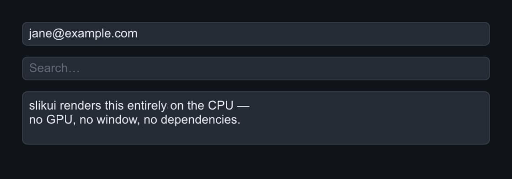
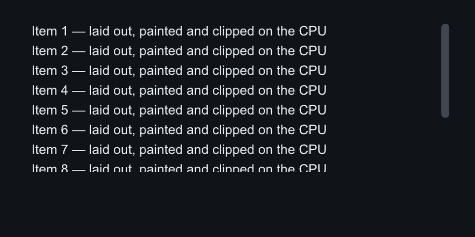

# Text inputs

Single-line and multiline editing, wrapping scroll areas, and the two
composites that dress them up (`SearchBox`, `GroupBox`).

## TextField

Single-line editing with caret, drag/Shift+arrow selection, Home/End/arrow
navigation, and auto-scroll. `on_change` fires on every edit, `on_submit` on
Enter. `set_password` masks the field. Ctrl/Cmd+A/C/X/V read and write the
host clipboard via `ctx.set_clipboard_source/sink` (the GLFW backend wires
the system clipboard; without a host the shortcuts are silent no-ops).

=== "C++"

    ```cpp
    root.add<slikui::TextField>().set_text("jane@example.com").set_placeholder("you@host");
    root.add<slikui::TextField>().set_placeholder("Search…");
    ```

=== "Python"

    ```python
    root.add(slikui.TextField, text="jane@example.com", placeholder="you@host")
    root.add(slikui.TextField, placeholder="Search…")
    ```

## TextArea

The multiline variant: same editing model plus wrapped rows. `set_rows`
suggests a height in lines.

=== "C++"

    ```cpp
    root.add<slikui::TextArea>().set_rows(3)
        .set_text("slikui renders this entirely on the CPU —\n"
                  "no GPU, no window, no dependencies.");
    ```

=== "Python"

    ```python
    root.add(slikui.TextArea, rows=3,
             text="slikui renders this entirely on the CPU —\n"
                  "no GPU, no window, no dependencies.")
    ```



| API (both) | Signature |
|------------|-----------|
| `set_text` | `(std::string)` |
| `set_placeholder` | `(std::string)` |
| `on_change` | `(std::function<void(const std::string&)>)` |
| `set_password` | TextField only — `(bool)` |
| `on_submit` | TextField only — `(std::function<void()>)` — fires on Enter |
| `set_rows` | TextArea only — `(int)` |

## ScrollArea

A scrolling viewport for one child. The child is measured at its natural
size; wheel and drag scroll it, and the offset clamps whenever content or
viewport heights change (including window resizes).

=== "C++"

    ```cpp
    auto& scroll = root.add<slikui::ScrollArea>();
    for (int i = 1; i <= 12; ++i)
        scroll.add<slikui::Label>("Item " + std::to_string(i) +
                                  " — laid out, painted and clipped on the CPU");
    ```

=== "Python"

    ```python
    scroll = root.add(slikui.ScrollArea)
    for i in range(1, 13):
        scroll.add(slikui.Label,
                   f"Item {i} — laid out, painted and clipped on the CPU")
    ```



## SearchBox and GroupBox

These two dress up the inputs above, but they are pictured with the shells
family (a GroupBox + SearchBox + LogView row in the capture) — see
[Shells & dialogs](widgets-shells.md#groupbox).

!!! note

    `SearchBox` wraps `TextField` (`set_placeholder`, `on_change` on every
    edit, `on_submit` on Enter); `GroupBox` is a titled `Panel`.
