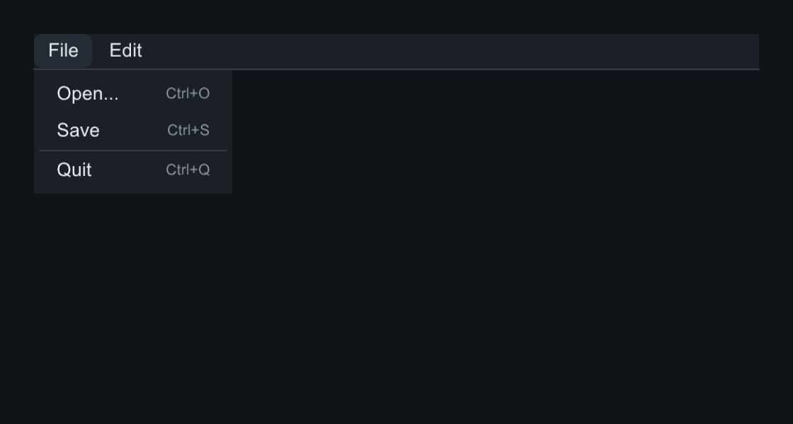
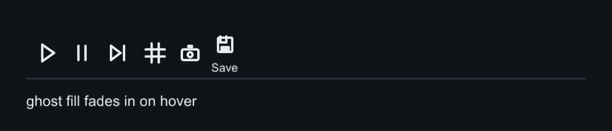
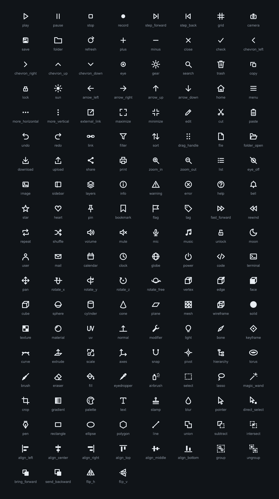

# Menus & toolbars

## MenuBar and Menu

`MenuBar` is a top strip of menu titles: click to open, click again to close,
and with a menu open, hovering another title switches to it. `Menu` holds
items (`add_item`, `add_checkable`, `add_submenu`, `add_separator`) with
right-aligned shortcut hints; disabled items swallow clicks.

Menus are **borrowed** popups - build once, open many times. Checkmark state
is read through a callback at paint time and `on_open` fires before each show
so you can refresh enabled flags; `on_close` fires whenever the menu leaves
the screen (item chosen, click outside, Escape, another menu opened, focus
lost), after the event that closed it. Escape unwinds submenus one level per
press.

The capture below opens the **File** menu by simulating a click on it:

=== "C++"

    ```cpp
    auto& bar = root.add<slikui::MenuBar>();
    auto& file = bar.add_menu("File");
    file.add_item("Open...", open_fn, "Ctrl+O");
    file.add_item("Save", save_fn, "Ctrl+S");
    file.add_separator();
    file.add_item("Quit", quit_fn, "Ctrl+Q");
    auto& edit = bar.add_menu("Edit");
    edit.add_item("Undo", undo_fn, "Ctrl+Z");
    edit.add_item("Redo", redo_fn, "Ctrl+Shift+Z", /*enabled=*/false);
    ```

=== "Python"

    ```python
    bar = root.add(slikui.MenuBar)
    file = bar.add_menu("File")
    file.add_item("Open...", open_fn, hint="Ctrl+O")
    file.add_item("Save", save_fn, hint="Ctrl+S")
    file.add_separator()
    file.add_item("Quit", quit_fn, hint="Ctrl+Q")
    edit = bar.add_menu("Edit")
    edit.add_item("Undo", undo_fn, hint="Ctrl+Z")
    edit.add_item("Redo", redo_fn, hint="Ctrl+Shift+Z", enabled=False)
    ```



| API | Signature |
|-----|-----------|
| `MenuBar::add_menu` | `(title) -> Menu&` |
| `MenuBar::set_background` | `(Color)` - default transparent: the window background shows, as with `Toolbar` |
| `Menu::add_item` | `(label, fn, hint = "", enabled = true)` |
| `Menu::add_checkable` | `(label, is_checked_fn, on_toggle_fn)` |
| `Menu::add_submenu` | `(label) -> Menu&` |
| `Menu::add_separator` | `()` |

## Context menus and global shortcuts

Any widget can carry a right-click menu: `widget.set_context_menu(&menu)` -
the nearest ancestor with one wins. Global accelerators live on the Context:
`ctx.add_shortcut(Key, mods, fn)` fires before widget dispatch (a modifier is
required, so typing never triggers one).

=== "C++"

    ```cpp
    viewport.set_context_menu(&view_menu);          // right-click
    ctx.add_shortcut(slikui::Key::R, slikui::ModCtrl, render_fn);
    ```

=== "Python"

    ```python
    viewport.set_context_menu(view_menu)            # right-click
    ui.ctx.add_shortcut(slikui.Key.R, slikui.mods("ctrl"), render_fn)
    ```


## Toolbar, IconButton

`Toolbar` is a strip of `IconButton`s - Button interaction (hover/press
animation, keyboard activation, variants) with a procedural icon instead of
text. `Toolbar::add_button(icon, fn, tip?)` renders an icon button;
`add_button(icon, label, fn)` renders a small caption under the icon.

=== "C++"

    ```cpp
    auto& bar = root.add<slikui::Toolbar>();
    bar.add_button(slikui::Icon::Play, run_fn, "Run");
    bar.add_button(slikui::Icon::Pause, pause_fn);
    bar.add_button(slikui::Icon::StepForward, step_fn);
    bar.add_separator();
    bar.add_button(slikui::Icon::Grid, grid_fn, "Toggle grid");
    bar.add_button(slikui::Icon::Camera, camera_fn, "Screenshot");
    bar.add_button(slikui::Icon::Save, "Save", save_fn);   // labeled
    root.add<slikui::Label>("ghost fill fades in on hover");
    ```

=== "Python"

    ```python
    bar = root.add(slikui.Toolbar)
    bar.add_button(slikui.Icon.Play, run_fn, tip="Run")
    bar.add_button(slikui.Icon.Pause, pause_fn)
    bar.add_button(slikui.Icon.StepForward, step_fn)
    bar.add_separator()
    bar.add_button(slikui.Icon.Grid, grid_fn, tip="Toggle grid")
    bar.add_button(slikui.Icon.Camera, camera_fn, tip="Screenshot")
    bar.add_labeled_button(slikui.Icon.Save, "Save", save_fn)
    root.add(slikui.Label, "ghost fill fades in on hover")
    ```



| API | Signature |
|-----|-----------|
| `Toolbar::add_button` | `(Icon, fn, tip)` - returns `IconButton&` |
| `Toolbar::add_button` (labeled) | `(Icon, label, fn)` | Python: `add_labeled_button` |
| `Toolbar::set_icon_px` / `set_background` | strip styling |
| `IconButton::set_icon` | `(Icon)` | `set_icon_px` | `set_variant` | `on_click` |
| `IconButton::set_icon_painter` | `(IconPainter)` - a custom icon, see below |

### Built-in icons

`slikui::Icon` (Python: `slikui.Icon`) has 156 procedural icons. They're drawn
from `DrawList` lines and shapes on a 24x24 grid, so they take the theme
colour and stay sharp at any size. The labels below are `icon_name(icon)`.
The enum names are the CamelCase form, so `more_horizontal` is
`Icon::MoreHorizontal`. New icons are added at the end, so existing enum
values don't change.



To draw an icon in a custom widget, call
`paint_icon(env.list, icon, rect, color)` (Python: `slikui.paint_icon`;
`slikui.icon_name(icon)` gives the name). `icon_count` is the number of
icons, so `static_cast<Icon>(i)` is valid for every `i` in `[0, icon_count)`.

## The icon set

The icon set in `slikui/widgets/icons.hpp` (~26 icons: play, pause, step,
grid, camera, save, refresh, search, ...) is painted from DrawList
primitives - no icon font, no assets, resolution-independent and
theme-tinted. The full list is the `slikui::Icon` enum (`slikui.Icon.*` in
Python).

### Custom icons

For an icon the set doesn't have, give the button a painter. It's called
each frame with the icon's square `area` and the `color` a built-in icon
would get (theme text, accent text on Primary/Danger, dimmed when disabled),
so a custom icon follows the theme like the rest. Draw on the same 24x24 grid
as the built-ins by scaling with `area.w / 24`, or start from a built-in and
add to it. `set_icon(Icon)` switches back.

=== "C++"

    ```cpp
    auto& pin = bar.add_button(slikui::Icon::Pin, toggle_pin);
    pin.set_icon_painter([](slikui::DrawList& l, slikui::Rect a, slikui::Color c) {
        slikui::paint_icon(l, slikui::Icon::Pin, a, c);
        l.circle({a.x + a.w * .85f, a.y + a.h * .15f}, a.w * .15f, c); // a badge
    });
    ```

=== "Python"

    ```python
    def pinned_icon(lst, area, color):
        slikui.paint_icon(lst, slikui.Icon.Pin, area, color)
        lst.circle(slikui.Vec2(area.x + area.w * .85, area.y + area.h * .15),
                   area.w * .15, color)  # a badge

    bar.add_button(slikui.Icon.Pin, toggle_pin).set_icon_painter(pinned_icon)
    ```

In Python the list handed to the painter is valid only during the call.

