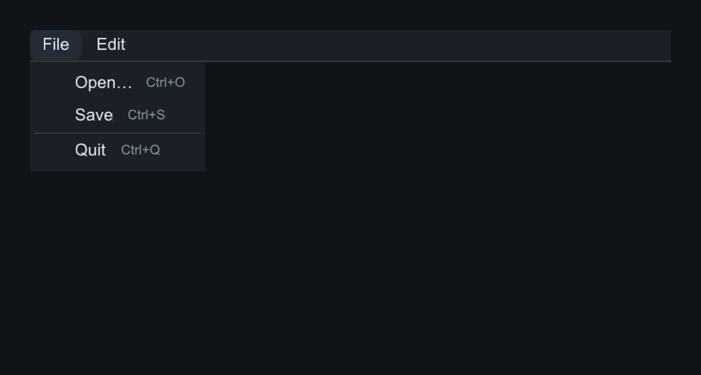
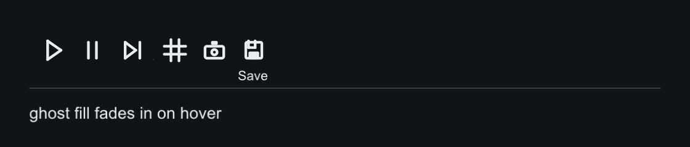

# Menus & toolbars

## MenuBar and Menu

`MenuBar` is a top strip of menu titles: click to open, click again to close,
and with a menu open, hovering another title switches to it. `Menu` holds
items (`add_item`, `add_checkable`, `add_submenu`, `add_separator`) with
right-aligned shortcut hints; disabled items swallow clicks.

Menus are **borrowed** popups — build once, open many times. Checkmark state
is read through a callback at paint time and `on_open` fires before each show
so you can refresh enabled flags. Escape unwinds submenus one level per
press.

The capture below opens the **File** menu by simulating a click on it:

=== "C++"

    ```cpp
    auto& bar = root.add<slikui::MenuBar>();
    auto& file = bar.add_menu("File");
    file.add_item("Open…", open_fn, "Ctrl+O");
    file.add_item("Save", save_fn, "Ctrl+S");
    file.add_separator();
    file.add_item("Quit", quit_fn, "Ctrl+Q");
    auto& edit = bar.add_menu("Edit");
    edit.add_item("Undo", undo_fn, "Ctrl+Z");
    edit.add_item("Redo", redo_fn, "Ctrl+Shift+Z", /*enabled=*/false);
    ```

=== "Python"

    ```python
    bar = root.add(slikui.MenuBar)
    file = bar.add_menu("File")
    file.add_item("Open…", open_fn, hint="Ctrl+O")
    file.add_item("Save", save_fn, hint="Ctrl+S")
    file.add_separator()
    file.add_item("Quit", quit_fn, hint="Ctrl+Q")
    edit = bar.add_menu("Edit")
    edit.add_item("Undo", undo_fn, hint="Ctrl+Z")
    edit.add_item("Redo", redo_fn, hint="Ctrl+Shift+Z", enabled=False)
    ```



| API | Signature |
|-----|-----------|
| `MenuBar::add_menu` | `(title) -> Menu&` |
| `Menu::add_item` | `(label, fn, hint = "", enabled = true)` |
| `Menu::add_checkable` | `(label, is_checked_fn, on_toggle_fn)` |
| `Menu::add_submenu` | `(label) -> Menu&` |
| `Menu::add_separator` | `()` |

## Context menus and global shortcuts

Any widget can carry a right-click menu: `widget.set_context_menu(&menu)` —
the nearest ancestor with one wins. Global accelerators live on the Context:
`ctx.add_shortcut(Key, mods, fn)` fires before widget dispatch (a modifier is
required, so typing never triggers one).

=== "C++"

    ```cpp
    viewport.set_context_menu(&view_menu);          // right-click
    ctx.add_shortcut(slikui::Key::R, slikui::ModCtrl, render_fn);
    ```

=== "Python"

    ```python
    viewport.set_context_menu(view_menu)            # right-click
    ui.ctx.add_shortcut(slikui.Key.R, slikui.mods("ctrl"), render_fn)
    ```


## Toolbar, IconButton

`Toolbar` is a strip of `IconButton`s — Button interaction (hover/press
animation, keyboard activation, variants) with a procedural icon instead of
text. `Toolbar::add_button(icon, fn, tip?)` renders an icon button;
`add_button(icon, label, fn)` renders a small caption under the icon.

=== "C++"

    ```cpp
    auto& bar = root.add<slikui::Toolbar>();
    bar.add_button(slikui::Icon::Play, run_fn, "Run");
    bar.add_button(slikui::Icon::Pause, pause_fn);
    bar.add_button(slikui::Icon::StepForward, step_fn);
    bar.add_separator();
    bar.add_button(slikui::Icon::Grid, grid_fn, "Toggle grid");
    bar.add_button(slikui::Icon::Camera, camera_fn, "Screenshot");
    bar.add_button(slikui::Icon::Save, "Save", save_fn);   // labeled
    root.add<slikui::Label>("ghost fill fades in on hover");
    ```

=== "Python"

    ```python
    bar = root.add(slikui.Toolbar)
    bar.add_button(slikui.Icon.Play, run_fn, tip="Run")
    bar.add_button(slikui.Icon.Pause, pause_fn)
    bar.add_button(slikui.Icon.StepForward, step_fn)
    bar.add_separator()
    bar.add_button(slikui.Icon.Grid, grid_fn, tip="Toggle grid")
    bar.add_button(slikui.Icon.Camera, camera_fn, tip="Screenshot")
    bar.add_labeled_button(slikui.Icon.Save, "Save", save_fn)
    root.add(slikui.Label, "ghost fill fades in on hover")
    ```



| API | Signature |
|-----|-----------|
| `Toolbar::add_button` | `(Icon, fn, tip)` — returns `IconButton&` |
| `Toolbar::add_button` (labeled) | `(Icon, label, fn)` · Python: `add_labeled_button` |
| `Toolbar::set_icon_px` / `set_background` | strip styling |
| `IconButton::set_icon` | `(Icon)` · `set_icon_px` · `set_variant` · `on_click` |

## The icon set

The icon set in `slikui/widgets/icons.hpp` (~26 icons: play, pause, step,
grid, camera, save, refresh, search, ...) is painted from DrawList
primitives — no icon font, no assets, resolution-independent and
theme-tinted. The full list is the `slikui::Icon` enum (`slikui.Icon.*` in
Python).
