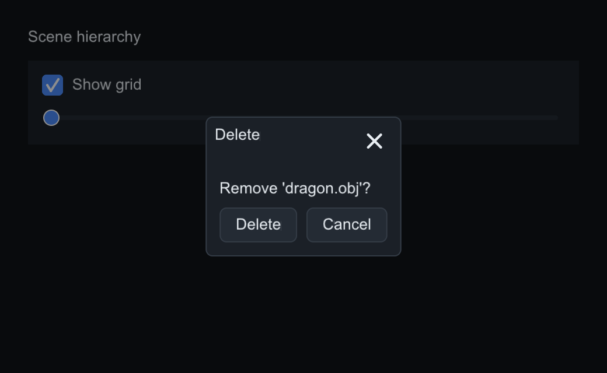
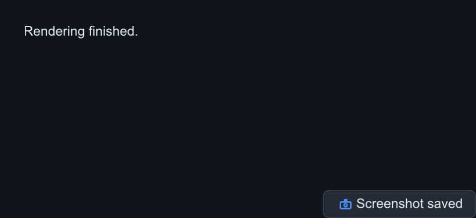
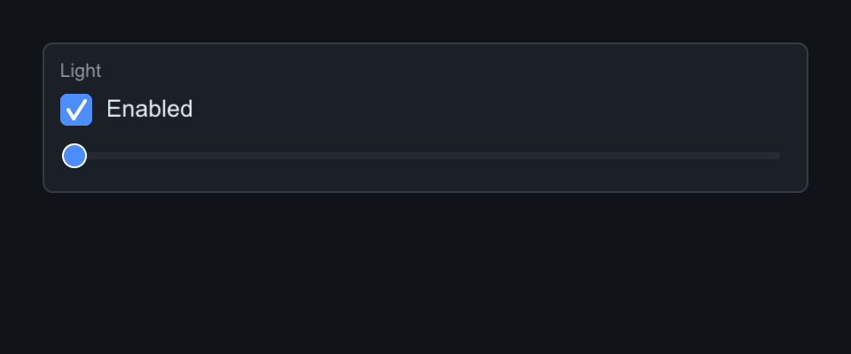
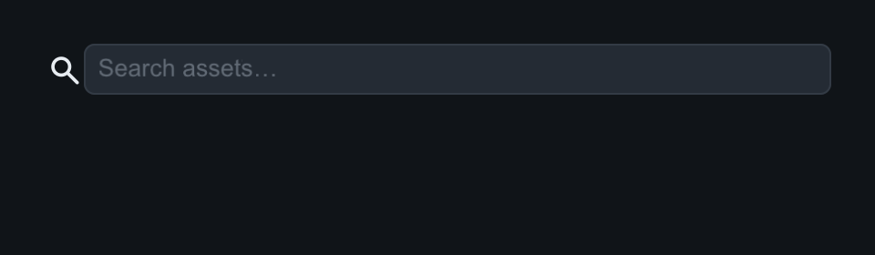
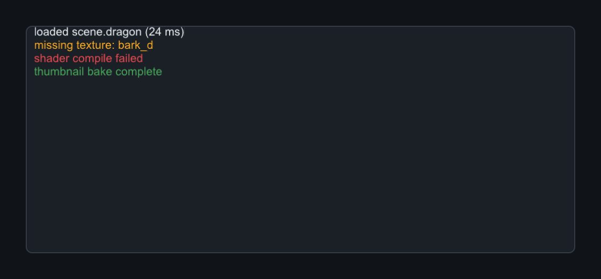
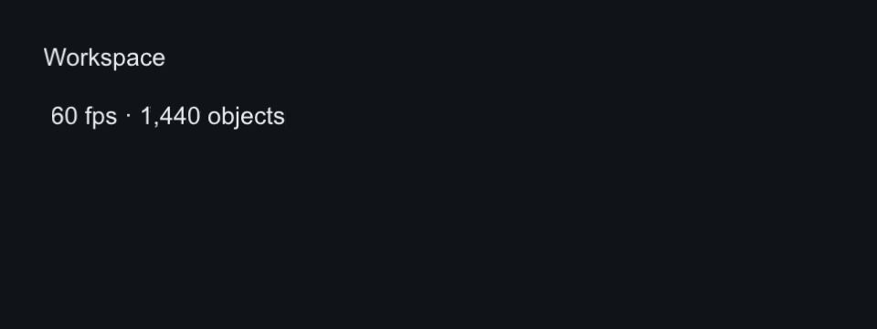
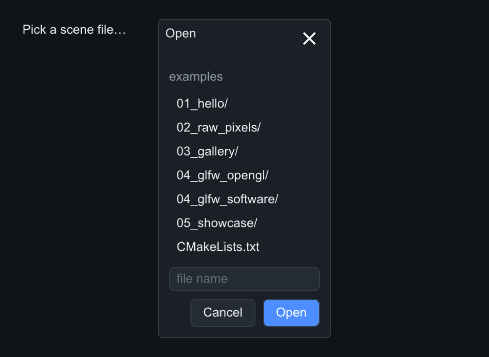
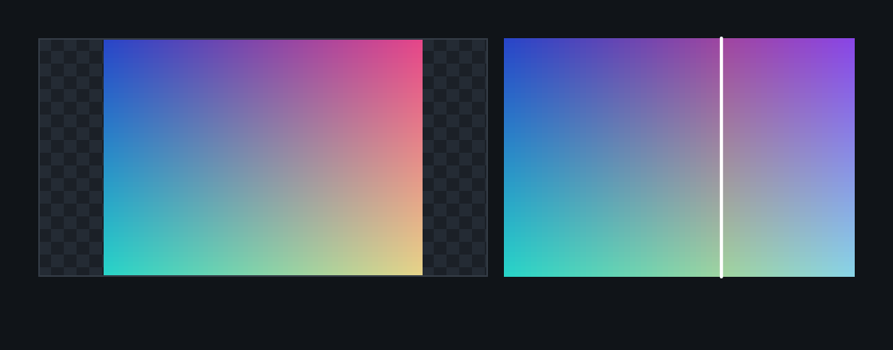
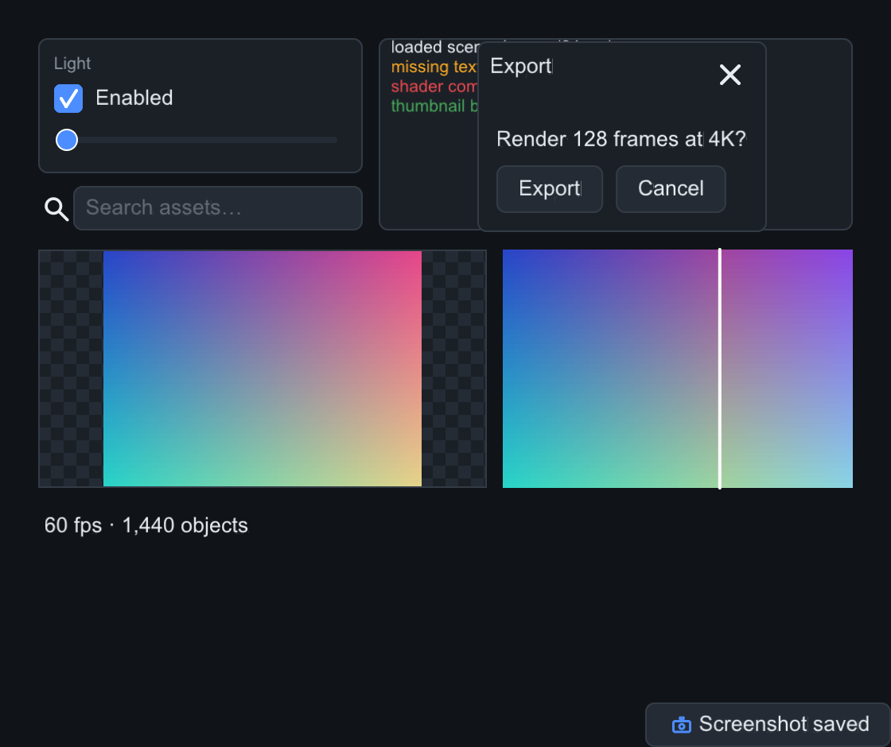

# Shells & dialogs

Floating shells live on their own layer above popups: dialogs and message
boxes, toasts, the status bar, the log console, and the image viewers.
`GroupBox` and `SearchBox` are pictured here too — they are simple composites
(a titled `Panel` and a `TextField` with magnifier/clear) that share the
family's capture.

## Dialog and MessageBox

`Dialog` has a draggable title bar with a close button and a `content()`
column. `MessageBox` adds an action-button row. A **modal** dialog dims the
app and traps presses outside it. Escape or the ✕ button closes.

=== "C++"

    ```cpp
    auto mb = std::make_unique<slikui::MessageBox>("Delete", "Remove 'dragon.obj'?");
    mb->set_modal(true);
    mb->add_button("Delete", [&] { remove_item(); });
    mb->add_button("Cancel", nullptr);
    ctx.open_dialog(std::move(mb));   // owned; or open_dialog(mb) to borrow
    ```

=== "Python"

    ```python
    mb = slikui.MessageBox("Delete", "Remove 'dragon.obj'?")
    mb.set_modal(True)
    mb.add_button("Delete", lambda: remove_item())
    mb.add_button("Cancel", lambda: None)
    ui.ctx.open_dialog(mb)            # borrowed — keep the Python object alive
    ```



| API | Signature |
|-----|-----------|
| `set_title` | `(std::string)` |
| `set_modal` | `(bool)` |
| `set_position` | `(Vec2)` |
| `on_close` | `(std::function<void()>)` |
| `add_button` | MessageBox — `(label, fn)` |

## Toast

Auto-dismissing corner notices: `ctx.push_toast(std::make_unique<Toast>("Saved"), 3.0)`
— the second argument is the lifetime in seconds. `set_icon(Icon)` adds a
procedural icon.

=== "Python"

    ```python
    ui.ctx.push_toast("Saved", 3.0)
    ```



## GroupBox

A titled panel — a `Panel` with a caption, for grouping related controls.

=== "C++"

    ```cpp
    auto& gb = left.add<slikui::GroupBox>("Light");
    gb.add<slikui::Checkbox>("Enabled", true);
    gb.add<slikui::Slider>(0.f, 1.f);
    ```

=== "Python"

    ```python
    gb = left.add(slikui.GroupBox, "Light")
    gb.add(slikui.Checkbox, "Enabled", True)
    gb.add(slikui.Slider, 0, 1)
    ```



## SearchBox

A `TextField` with a magnifier icon and a clear button. `on_change` fires on
every edit, `on_submit` on Enter.

=== "C++"

    ```cpp
    left.add<slikui::SearchBox>().set_placeholder("Search assets…");
    ```

=== "Python"

    ```python
    left.add(slikui.SearchBox, placeholder="Search assets…")
    ```



## LogView

A severity-colored autoscrolling console — pair it with `StatusBar` for
feedback, or feed it event logs from demo panels (the showcase does exactly
this).

=== "C++"

    ```cpp
    auto& log = top.add<slikui::LogView>();
    log.log(slikui::LogView::Level::Info, "loaded scene.dragon (24 ms)");
    log.log(slikui::LogView::Level::Warning, "missing texture: bark_d");
    log.log(slikui::LogView::Level::Error, "shader compile failed");
    log.log(slikui::LogView::Level::Success, "thumbnail bake complete");
    ```

=== "Python"

    ```python
    log = top.add(slikui.LogView)
    log.log(slikui.LogView.Level.Info, "loaded scene.dragon (24 ms)")
    log.log(slikui.LogView.Level.Warning, "missing texture: bark_d")
    log.log(slikui.LogView.Level.Error, "shader compile failed")
    log.log(slikui.LogView.Level.Success, "thumbnail bake complete")
    ```



## StatusBar

Status text with transient messages plus right-side widgets — a typical home
for `Spinner`s or scale indicators.

=== "C++"

    ```cpp
    root.add<slikui::StatusBar>().set_text("60 fps · 1,440 objects");
    ```

=== "Python"

    ```python
    root.add(slikui.StatusBar).set_text("60 fps · 1,440 objects")
    ```



## FileBrowser

Lists real directories for Open/Save flows. `set_path` starts it somewhere;
`on_pick(path)` receives the result.

=== "C++"

    ```cpp
    auto fb = std::make_unique<slikui::FileBrowser>(slikui::FileBrowser::Mode::Open);
    fb->on_pick([](const std::string& path) { load_file(path); });
    ctx.open_dialog(std::move(fb));
    ```

=== "Python"

    ```python
    fb = slikui.FileBrowser(slikui.FileBrowser.Mode.Open)
    fb.on_pick(lambda path: load_file(path))
    ui.ctx.open_dialog(fb)
    ```



## ImageView and CompareView

`ImageView` pans/zooms RGBA bitmaps over a checkerboard; `CompareView` splits
two images with a draggable divider (`set_fraction`). Both take pixels via
`set_pixels` / `set_pixels_a` / `set_pixels_b`.

=== "C++"

    ```cpp
    auto& views = root.add<slikui::Row>();
    views.set_gap(10);
    views.add<slikui::ImageView>().set_pixels(64, 48, grad.data());
    auto& cv = views.add<slikui::CompareView>();
    cv.set_pixels_a(64, 48, grad.data());
    cv.set_pixels_b(64, 48, grad2.data());
    cv.set_fraction(.62f);
    ```

=== "Python"

    ```python
    views = root.add(slikui.Row, gap=10)
    views.add(slikui.ImageView).set_pixels(64, 48, grad)
    cv = views.add(slikui.CompareView)
    cv.set_pixels_a(64, 48, grad)
    cv.set_pixels_b(64, 48, grad_rb)
    cv.set_fraction(0.62)
    ```



## As pictured

Every image on this site is real output from `tools/components_capture.cpp`
(`gradient_rgba()` there builds a small RGBA test bitmap). The capture opens
the MessageBox dialog and posts a toast, so both appear over the panel:

=== "C++"

    ```cpp
    auto grad = gradient_rgba();                       // helper in the capture tool
    std::vector<std::uint8_t> grad2 = grad;
    for (std::size_t i = 0; i < grad2.size(); i += 4)
        std::swap(grad2[i], grad2[i + 2]);             // R/B swapped for image B

    auto& top = root.add<slikui::Row>();
    top.set_gap(10);
    auto& left = top.add<slikui::Column>();
    left.set_gap(8);
    auto& gb = left.add<slikui::GroupBox>("Light");
    gb.add<slikui::Checkbox>("Enabled", true);
    gb.add<slikui::Slider>(0.f, 1.f);
    left.add<slikui::SearchBox>().set_placeholder("Search assets…");
    auto& log = top.add<slikui::LogView>();
    log.log(slikui::LogView::Level::Info, "loaded scene.dragon (24 ms)");
    log.log(slikui::LogView::Level::Warning, "missing texture: bark_d");
    log.log(slikui::LogView::Level::Error, "shader compile failed");
    log.log(slikui::LogView::Level::Success, "thumbnail bake complete");

    auto mb = std::make_unique<slikui::MessageBox>("Export", "Render 128 frames at 4K?");
    mb->add_button("Export", nullptr);
    mb->add_button("Cancel", nullptr);
    mb->set_position({300, 26});
    ctx.open_dialog(std::move(mb));
    auto toast = std::make_unique<slikui::Toast>("Screenshot saved");
    toast->set_icon(slikui::Icon::Camera);
    ctx.push_toast(std::move(toast), 60.0);

    auto& views = root.add<slikui::Row>();
    views.set_gap(10);
    views.add<slikui::ImageView>().set_pixels(64, 48, grad.data());
    auto& cv = views.add<slikui::CompareView>();
    cv.set_pixels_a(64, 48, grad.data());
    cv.set_pixels_b(64, 48, grad2.data());
    cv.set_fraction(.62f);
    root.add<slikui::StatusBar>().set_text("60 fps · 1,440 objects");
    ```

=== "Python"

    ```python
    grad, grad_rb = ...  # small RGBA gradients — see python/examples/gallery.py

    top = root.add(slikui.Row, gap=10)
    left = top.add(slikui.Column, gap=8)
    gb = left.add(slikui.GroupBox, "Light")
    gb.add(slikui.Checkbox, "Enabled", True)
    gb.add(slikui.Slider, 0, 1)
    left.add(slikui.SearchBox, placeholder="Search assets…")
    log = top.add(slikui.LogView)
    log.log(slikui.LogView.Level.Info, "loaded scene.dragon (24 ms)")
    log.log(slikui.LogView.Level.Warning, "missing texture: bark_d")
    log.log(slikui.LogView.Level.Error, "shader compile failed")
    log.log(slikui.LogView.Level.Success, "thumbnail bake complete")

    mb = slikui.MessageBox("Export", "Render 128 frames at 4K?")
    mb.add_button("Export", lambda: None)
    mb.add_button("Cancel", lambda: None)
    mb.set_position(slikui.Vec2(300, 26))
    ui.ctx.open_dialog(mb)
    ui.ctx.push_toast("Screenshot saved", 60.0)   # icon: Toast.set_icon in C++

    views = root.add(slikui.Row, gap=10)
    views.add(slikui.ImageView).set_pixels(64, 48, grad)
    cv = views.add(slikui.CompareView)
    cv.set_pixels_a(64, 48, grad)
    cv.set_pixels_b(64, 48, grad_rb)
    cv.set_fraction(0.62)
    root.add(slikui.StatusBar).set_text("60 fps · 1,440 objects")
    ```



!!! tip

    Widgets can request cursor shapes via `set_cursor` — hosts map them to
    system cursors (`GlfwWindow::attach` does this). See
    [Input & events](../guide/input-events.md#cursor-shapes).
