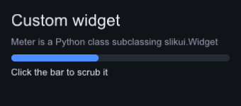

# slikui — Python bindings for slikui

Install from PyPI · import `slikui` · compiled module `slikui._slikui`.

```sh
pip install slikui-python
```

pip picks the wheel matching your OS, CPU and Python (3.10–3.14 on Linux
x86_64/aarch64, macOS arm64, Windows x64). No wheel for your platform (e.g.
Intel macOS)? pip builds from the sdist instead — that needs a C++20 compiler.

The same wheels and sdist are attached to every
[GitHub Release](https://github.com/jamesgregson/slikui/releases).

Headless, testable UI: the software rasterizer renders into a `numpy`
framebuffer — no window, no GPU, no event loop required.

```python
import slikui

ui = slikui.App(320, 200)                     # Target + Sink + Context + font (system, else bundled)
root = ui.set_root(slikui.Column, padding=16, gap=8)
root.add(slikui.Label, "Hello, slikui!", font_size=26)
root.add(slikui.Button, "Save", variant=slikui.ButtonVariant.Primary)

ui.tick(0.0, 1 / 60)                        # layout + animation
frame = ui.render()                         # zero-copy np.ndarray (H, W) uint32
```

`App.close()` — also run by `with App(...)` and automatically at exit —
destroys the tree and releases Python callbacks it holds, so shutdown is
leak-free even when callbacks capture widget wrappers.

Build from source (the C++ side is header-only, nothing to link):

```
pip install -e .                # editable, into your venv — from the repo root
python -m pytest python/tests   # widgets, events, custom widgets, renderer parity
python python/examples/hello.py # writes hello.png
```

Events are first-class: build slikui events in Python and drive the real
dispatch path (see `python/tests/test_events.py`):

```python
ui.handle(slikui.mouse_press((60, 40)))   # click through hit-testing
ui.handle(slikui.text_input("h"))         # into the focused TextField
ui.handle(slikui.scroll(pos, (0, -1)))    # wheel, "ctrl+shift" mods supported
```

**Editors for demo panels.** `DragValue` scrubs numbers (click to type,
Enter commits), `Vec2Edit`/`Vec3Edit`/`Vec4Edit` bind a borrowed numpy
`float32` array — edits write into it, external writes mirror back each tick —
`ColorEdit` opens an SV/hue popup, and `Slider` grows a built-in
label + live-value row (`label=`, `format=`, `log_scale=`, `step=`).
`TextField` has selection and Ctrl/Cmd+A/C/X/V via host clipboard callbacks
(`ctx.set_clipboard_source/sink`; the GLFW backend wires the system
clipboard). New widgets land C++-first so both languages get them — see
`docs/widgets-roadmap.md`.

**Menus, toolbars, data display.** `MenuBar`/`Menu` build once and open as
borrowed popups (checkmarks read through callbacks, `on_open` refresh hook,
submenus, right-aligned shortcut hints via `slikui.shortcut_label`);
`ctx.add_shortcut(key, mods, fn)` runs global accelerators, and
`widget.set_context_menu(menu)` right-clicks. `Toolbar` lays out
`IconButton`s with a procedural icon set (`slikui.Icon.*` — painted from
draw-list primitives, no assets). For data panels: `Plot` (numpy series,
autoscale or fixed ranges, bars/fill/markers), `TreeView` (flat
`TreeView.Row` lists with expand/collapse), `Table` (`Table.ColumnSpec`
columns, selectable rows), `PropertyGrid` (`add_property("Roughness")` then
`row.add(slikui.Slider, 0, 1)`), and `Vec2Pad` for 2D values.

**Dialogs, toasts, logs & image views.** `Dialog`/`MessageBox` float on the shell layer above popups (`ctx.open_dialog` — Escape or the ✕ button closes; modal dialogs dim + trap). `ctx.push_toast(text, seconds)` posts auto-dismissing corner notices. `StatusBar`/`LogView` give feedback, `SearchBox`/`GroupBox` wrap inputs, `FileBrowser` browses real directories (Open/Save + `on_pick`), and `ImageView`/`CompareView` pan, zoom and split RGBA bitmaps. Widgets request cursor shapes (`slikui.Cursor`) through `ctx.set_cursor_host`.

Interactive demo — a Python-native GLFW + OpenGL host with the slikui software
rasterizer as the UI layer (`pip install glfw PyOpenGL`):

```
python python/examples/glfw_demo.py
```

Lit cube/sphere/torus over a procedural sky; the controls panel is rasterized
on the CPU into a `uint32` buffer and blended over the GL scene as one
texture. Drag orbits, wheel zooms, the panel edits material/sky/light/camera.

The showcase twin — every widget live in one window, each printing its state
changes into the on-screen event log, with two custom widgets (`Fill` and a
scrubbable `LevelMeter`) exercising the measure/paint/event/tick contract.
It is the one-for-one mirror of the C++ `examples/05_showcase`; their
`--smoke` transcripts match line for line:

```
python python/examples/showcase.py              # interactive GLFW window
python python/examples/showcase.py --smoke out.png   # headless scripted pass
```

**Your own renderer.** `slikui.RenderSink` is a trampoline over C++
`IRenderSink`: subclass it, implement `upload(tex)` and `render(commands,
fb_size)`, and slikui hands you every frame as a flat command list — point it at
pygame, moderngl, PIL, anything. `slikui.CanvasSink` is a worked example: a
pure-numpy rasterizer that produces **pixel-identical** output to the C++
software backend (same blend/SDF/sampling math, verified by test):

```python
sink = slikui.CanvasSink(320, 240)
ctx = slikui.Context(sink)          # any RenderSink subclass works here
ctx.set_frame_size(320, 240)
ctx.load_default_font()           # bundled DejaVu Sans subset; or load_font_file(path)
# ... build the tree, tick ...
ctx.render()
frame = sink.buffer               # (240, 320) uint32, 0xAABBGGRR
```

See it side by side: `python python/examples/pyrenderer_demo.py` renders one
tree through both renderers and reports the pixel diff (it is 0).

**Custom widgets in pure Python.** Subclass `slikui.Widget` and implement
`measure` / `paint` / `on_event` (plus opt-in `tick`, `stretch_cross`,
`expands_main`, `focusable`, `widget_type`) — the C++ core lays out, paints,
hit-tests and dispatches events to your class:

```python
class Meter(slikui.Widget):
    def measure(self, constraints):
        return constraints.clamp(slikui.Size(0, 10))

    def paint(self, env):
        env.list.rect(self.bounds, self.value_color)

    def on_event(self, event):
        if event.type == slikui.EventType.MousePress \
                and self.bounds.contains(event.pos):
            ...  # return True to consume
        return False
```

Python state lives in instance attributes; `paint` emits into `env.list`
(rect, hollow_rect, line, circle, image, glyph, clip stack) using `env.theme`
colors. Add instances with `container.add_widget(obj)` or
`container.add(Meter, ...)`; a custom root is `context.set_root_widget(...)`.
Note: subclasses must call `super().__init__()`, and subclassing the bound C++
widget types (Column, Row, ...) is rejected — build layouts from Python code
instead. See `python/examples/custom_widget.py` and the pixel-parity test
against the C++ `Swatch` in `python/tests/test_custom_widgets.py`.



Milestones: M0 (values, software backend, core widgets), M1 (full widget
surface + themes), M2 (events, popups, tooltips, simulated-input tests) and
M3 (wheels/CI/docs) are done; M4 (GLFW+GL backend bindings) is tabled. The
widget set itself is tracked in `docs/widgets-roadmap.md`.